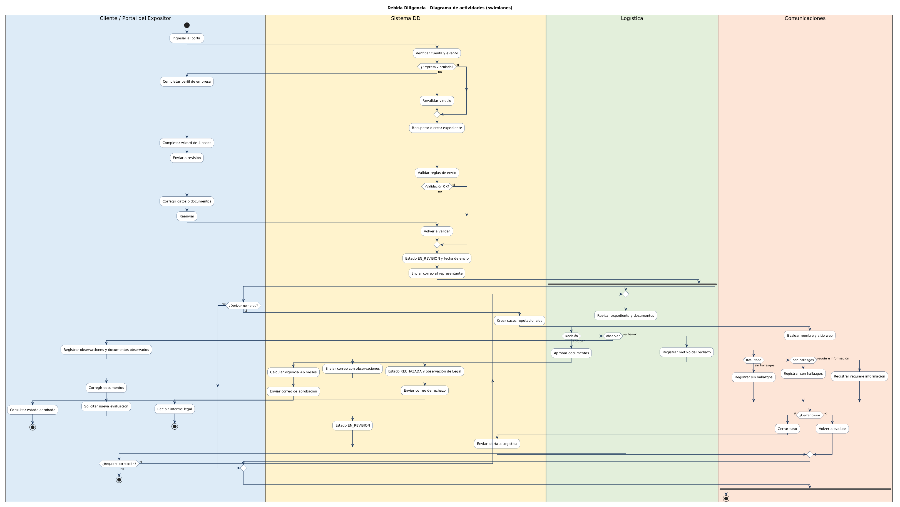

# Debida Diligencia (DD) - Documento funcional

> **Estado:** implementado y verificado en el repositorio.
> **Modulo:** Debida Diligencia (DD), separado del resto del sistema por permisos `dd:*`.
> **Diseno de referencia:** [`10-debida-diligencia-stitch.md`](./10-debida-diligencia-stitch.md).
> **Fuente de verdad tecnica:** `src/lib/shared/constants.ts`,
> `src/application/debida-diligencia/`,
> `src/infrastructure/persistence/debida-diligencia-repository.ts` y
> `docs/04-api/openapi.yaml`.

---

## 1. Proposito

Registrar y evaluar la debida diligencia de las empresas que participan en un evento
del IIMP. El modulo cubre:

- consentimiento de tratamiento de datos personales y derechos ARCO;
- consentimiento de debida diligencia reforzada;
- datos de la empresa, representante legal y beneficiarios finales con 10% o mas;
- carga y versionado de documentos de sustento;
- revision de Logistica;
- revision reputacional de Comunicaciones;
- revision legal de expedientes derivados por Logistica;
- vigencia de seis meses y panel de control por evento.

La debida diligencia aplica a empresas. La debida diligencia basica para personas
naturales pertenece a otros procesos del IIMP y no forma parte de este modulo.

---

## 2. Actores y permisos

Los permisos del modulo estan aislados con el prefijo `dd:`. El rol `admin` siempre
pasa por `admin:full`; los demas roles requieren el permiso explicito.

| Rol | Permisos DD | Uso |
|---|---|---|
| `admin` | todos (`admin:full`) | Acceso total y configuracion |
| `cliente` | `dd:formulario` | Completa el wizard de su empresa y consulta su estado |
| `logistica` | `dd:ver`, `dd:panel`, `dd:revision` | Revisa documentos, resuelve expedientes y deriva nombres |
| `comunicacion` | `dd:ver`, `dd:reputacion` | Revision reputacional de nombres y sitios web |
| `legal` | `dd:ver`, `dd:legal` | Revisa expedientes derivados, adjunta informe y resuelve |
| `asociado` | - | No participa en este modulo |

`dd:ver` es un permiso tecnico de consulta: habilita el detalle de expedientes y la
API de clientes, pero no agrega un item propio al menu. Los menus usan `dd:panel`,
`dd:revision`, `dd:legal`, `dd:reputacion` y `dd:formulario`.

Los permisos DD se configuran por rol en **Roles y Permisos**. La asignacion de
modulos por rol (`role.modulos`) permite habilitar las tarjetas de permisos de cada
modulo, incluida **Debida Diligencia**.

---

## 3. Rutas y pantallas

| Ruta | Pantalla | Acceso |
|---|---|---|
| `/dashboard/debida-diligencia` | Landing segun rol: panel, bandeja, legal, reputacion o mi debida diligencia | Autenticado |
| `/dashboard/debida-diligencia/formulario` | Wizard de 4 pasos | `dd:formulario` |
| `/dashboard/debida-diligencia/bandeja` | Bandeja de revision de Logistica | `dd:revision` |
| `/dashboard/debida-diligencia/legal` | Bandeja de revision legal | `dd:legal` |
| `/dashboard/debida-diligencia/reputacion` | Revision reputacional de Comunicaciones | `dd:reputacion` |

El sidebar agrupa los items por modulo y muestra **Debida Diligencia** como seccion.
El cliente ve **Mi debida diligencia**. Logistica ve **Panel DD** y **Bandeja DD**.
Legal ve **Revision legal**. Comunicaciones ve **Revision reputacional**.

---

## 4. Flujo funcional

### 4.1 Cliente (Portal del Expositor)

1. Ingresa con su cuenta y un evento activo.
2. Si su cuenta no esta vinculada a una empresa, el sistema lo envia al perfil.
3. Si no tiene expediente en el evento, se crea un borrador con codigo
   `DD-AAAA-NNNN`.
4. Completa el wizard:
   - **Paso 1 - Consentimientos:** datos personales/ARCO y debida diligencia
     reforzada. Ambos son obligatorios; **Continuar** permanece deshabilitado hasta
     aceptar los dos. Las respuestas se guardan y se recuperan al reabrir.
   - **Paso 2 - Empresa:** tipo de relacion comercial, razon social y RUC
     prellenados, pais de constitucion, actividad economica, sitio web y correo del
     representante legal. La actividad economica se alimenta del diccionario
     independiente `DD_ACTIVIDADES_ECONOMICAS` y se valida en frontend y backend.
   - **Paso 3 - Representante y beneficiarios:** nombre, tipo y numero de
     documento, nacionalidad y beneficiarios con 10% o mas. El documento del
     beneficiario se ingresa primero; al completar 8 digitos se consulta RENIEC o al
     completar 11 se consulta SUNAT para autocompletar el nombre. La nacionalidad solo
     admite letras y no valores numericos.
   - **Paso 4 - Documentos:** ficha RUC, vigencia de poderes, documento de identidad
     del representante y declaracion jurada firmada. Formatos PDF, JPG o PNG; maximo
     10 MB por archivo y validacion de firma binaria. No se aceptan Word, Excel ni
     PowerPoint. Cada documento muestra su historial de versiones y permite vista
     previa en modal.
5. Puede guardar borrador en cualquier paso. Los titulos de los pasos permiten
   navegar solo al paso actual y a los pasos ya completados; no se puede saltar a un
   paso posterior sin completar los anteriores.
6. Al enviar, se validan consentimientos, datos, documentos y declaracion jurada.
   Si todo esta completo, el expediente pasa a `en_revision` y se envia un correo al
   contacto declarado.
7. Si Logistica solicita correcciones, el cliente recibe las observaciones. Al abrir
   el formulario, el wizard inicia en el paso 4, resalta los documentos observados y
   el boton cambia a **Subir nueva version**. No puede reenviar mientras quede algun
   documento observado sin reemplazar.
8. Si Logistica rechaza y deriva a Legal, el cliente no recibe correo en ese paso.
   Recibe la decision definitiva cuando Legal rechaza, o cuando Logistica aprueba o
   rechaza despues de la revision legal.

### 4.2 Logistica

1. Abre la bandeja y filtra por estado, texto o empresa. La columna **Reputacion**
   resume los casos derivados y sus resultados.
2. Revisa el expediente, los documentos con sus versiones, las observaciones previas
   y la pestana **Reputacion**, que contiene la respuesta de Comunicaciones por cada
   nombre derivado.
3. Decide:
   - **Aprobar:** marca los documentos como aprobados, registra la aprobacion final y
     calcula la vigencia de seis meses. Recien en este momento la empresa queda apta
     y se envia el correo `dd-aprobada` al cliente.
   - **Solicitar correcciones:** registra una observacion general o marca documentos
     especificos. Los documentos marcados quedan observados; si no se marca ninguno,
     la observacion es general y no se altera el estado de los documentos.
   - **Derivar a Legal:** registra el motivo y envia el expediente a Legal en estado
     `en_legal`. El cliente no es notificado en este paso.
4. Si el expediente ya esta aprobado, solo puede derivarse a Legal; no admite una
   nueva aprobacion ni observacion.
5. Si marca **Derivar nombres a Comunicaciones**, se crean casos reputacionales para
   la empresa, el representante y los beneficiarios. No se duplican.
6. Toda decision queda en auditoria.

### 4.3 Comunicaciones

1. Recibe los nombres derivados por Logistica.
2. Evalua unicamente el nombre y el sitio web remitidos. No accede a la ficha
   completa del cliente.
3. Registra uno de estos resultados: sin hallazgos, con hallazgos o requiere
   informacion adicional.
4. Puede guardar el resultado o cerrar el caso. Al notificar, Logistica recibe una
   alerta en la campana del sistema.

### 4.4 Legal

1. Recibe en su bandeja los expedientes que Logistica derivo con estado `en_legal`.
2. Revisa la solicitud completa: empresa, representante, documentos, observaciones de
   Logistica y resultados de Comunicaciones.
3. Si va a **rechazar**, adjunta obligatoriamente el **informe legal en PDF**. Si
   aprueba, el informe es opcional.
4. Registra su decision:
   - **Aprobar:** el expediente vuelve a Logistica en estado `en_revision`. La empresa
     no queda apta todavia; Logistica debe registrar la decision final.
   - **Rechazar:** el expediente pasa a `rechazada` y recien en ese momento se
     notifica al cliente, con el informe legal disponible en **Mi debida diligencia**.
5. Toda decision legal queda en auditoria con revisor, fecha, motivo e informe.
6. Si Legal aprueba y Logistica rechaza despues, el rechazo es final y se notifica al
   cliente; no se vuelve a derivar a Legal.

### 4.5 Registro externo de empresas

La lista oficial de empresas con su estado de Debida Diligencia se puede importar
desde Excel y se expone mediante `GET /api/debida-diligencia/empresas`.

- `APTO`: empresa habilitada si la evaluacion esta VIGENTE.
- `APTO CON OBSERVACIONES`: habilitada solo para el vinculo evaluado.
- `NO APTO`: no habilitada.
- `PENDIENTE`: en revision o con documentacion observada.

Cada registro devuelve `puedeReservar` y `puedeAvanzar`. Una empresa pendiente
puede reservar, pero no avanzar hasta quedar APTA y vigente.

Importacion:

```bash
npx tsx scripts/import-dd-excel.ts "C:\ruta\RESULTADO DEBIDA DILIGENCIA.xlsx"
```

El import es idempotente por RUC/DNI/ID y no elimina registros que dejen de aparecer
en el archivo.

Fechas y evento de los registros importados:

- `FECHA DE INGRESO SOLICITUD` se guarda como `fechaEnvio` y representa el
  **inicio real de la solicitud**.
- `createdAt` es la fecha en que el registro se creo en la base local durante la
  importacion. No debe mostrarse como inicio de la solicitud.
- La bandeja y el export muestran ambas fechas: **Inicio solicitud** y
  **Creado en BD**.
- `EVENTO O PROYECTO ASOCIADO` determina la version de evento. PROEXPLO, WMC y
  GESS se separan; los valores operativos o sin evento permanecen en PERUMIN.
- La estrategia detallada de QA esta en
  [`docs/02-despliegue/importacion-dd-qa.md`](../02-despliegue/importacion-dd-qa.md).

### 4.6 Panel del modulo

Muestra KPIs, estado por vinculo, vigencia y matriz de empresas. La matriz es
server-side y permite buscar, filtrar por estado DD y vinculo, cambiar `perPage`,
recargar y exportar el resultado filtrado.

---

## 5. Diagrama de actividades (UML con swimlanes)

Diagrama de actividades UML con columnas por actor y actividades ordenadas por filas
(estilo Bizagi). Modela el proceso completo: cliente, sistema, Logistica, Legal y
Comunicaciones.

Mermaid no tiene notacion nativa de swimlanes/BPMN; para el diagrama de actividades se
usa PlantUML.

**Versiones renderizadas:** [SVG](./diagramas/debida-diligencia-actividades-uml.svg) - [PNG](./diagramas/debida-diligencia-actividades-uml.png)
**Fuente PlantUML:** [.puml](./diagramas/debida-diligencia-actividades-uml.puml)



---

## 6. Estados y transiciones

### 6.1 Expediente

| Estado | Significado | Transiciones |
|---|---|---|
| `borrador` | Creado por el cliente, aun no enviado | -> `en_revision` |
| `en_revision` | Pendiente de Logistica, o devuelto por Legal para decision final | -> `aprobada`, `observada`, `en_legal` |
| `observada` | Logistica solicito correcciones | -> `en_revision` al reenviar |
| `en_legal` | Derivado por Logistica para revision legal | -> `en_revision` si Legal aprueba, o `rechazada` si rechaza |
| `aprobada` | Aprobada por Logistica con vigencia de 6 meses | Estado final; empresa apta |
| `rechazada` | Rechazo definitivo | Estado final; informe legal cuando corresponde |

Constantes: `DD_ESTADOS` y `DD_ESTADO_LABELS`.

### 6.2 Documentos

`pendiente` -> `cargado` -> `observado` / `aprobado` / `rechazado`.

Un documento observado conserva la observacion mientras el cliente no suba una nueva
version con una URL distinta.

### 6.3 Revision reputacional

| Estado | Significado |
|---|---|
| `por_revisar` | Derivado por Logistica, pendiente de Comunicaciones |
| `en_analisis` | En evaluacion |
| `sin_hallazgos` | Resultado sin hallazgos |
| `con_hallazgos` | Resultado con hallazgos |
| `requiere_informacion` | Comunicaciones solicita mas informacion |
| `cerrada` | Caso cerrado |

Constantes: `DD_REPUTACION_ESTADOS` y `DD_REPUTACION_RESULTADO_A_ESTADO`.

---

## 7. Reglas de negocio

- En la portada del cliente, una DD **aprobada y vigente** prevalece sobre el evento
  activo: si no existe DD del evento actual pero hay una vigente de otro evento, se
  muestra esa DD con su linea de tiempo y no se ofrece iniciar una nueva.
- Si la DD vigente es de otro evento y no tiene la **Declaracion jurada de vigencia
  de informacion**, se ofrece un boton para regularizarla en el paso 4 de documentos.
  Si la DD vigente es del evento activo, no se muestra ese input.
- La declaracion de vigencia es un documento adicional opcional del flujo regular;
  solo es obligatoria cuando la empresa mantiene una DD importada aprobada y vigente.
- La vigencia de una debida diligencia aprobada es de **6 meses**, contados desde
  que queda **APTA/aprobada** (aprobacion final de Logistica o fecha de revision APTA
  importada), no desde el envio de la solicitud. Si falta la fecha de cese, se calcula
  como aprobacion + 6 meses; si tampoco existe fecha de aprobacion, no se inventa una
  vigencia y el expediente requiere una nueva evaluacion.
- Se considera **por vencer** cuando faltan **30 dias o menos**.
- Solo la aprobacion final de Logistica deja a la empresa **apta**. La aprobacion de
  Legal devuelve el expediente a Logistica y no activa la vigencia.
- Una empresa pendiente puede reservar un stand, pero no debe avanzar en aprobaciones
  hasta quedar aprobada.
- En Solicitudes, una DD **APTA y vigente de otro evento** sin la Declaracion jurada
  de vigencia de informacion se muestra como **APTO pendiente de declaracion** y
  bloquea la revision. Solo `admin:full` puede omitir el bloqueo.
- El bloqueo automatico del pipeline de reservas/solicitudes sigue como integracion
  pendiente.
- Un expediente solo se puede editar en `borrador` u `observada`.
- El envio exige ambos consentimientos, datos completos, representante, declaracion
  jurada y los cuatro documentos obligatorios.
- La carga de documentos se valida en backend: sesion y permiso, tipo de documento,
  extension, tamano maximo de 10 MB y firma binaria real (PDF/JPG/PNG). `guardar` y
  `enviar` revalidan que el archivo exista en storage y que su contenido sea valido.
- Los documentos PDF/imagen se pueden previsualizar en un modal. Los documentos de
  versiones anteriores se conservan y se pueden consultar.
- Los beneficiarios declarados deben tener al menos **10%** de participacion; el
  maximo es 100%.
- La nacionalidad del representante y de los beneficiarios solo admite letras,
  espacios, apostrofes, puntos y guiones.
- Logistica puede derivar nombres a Comunicaciones al resolver el expediente. Los
  casos se crean una sola vez por nombre.
- Comunicaciones no recibe la ficha completa: solo el nombre visible de la empresa,
  el nombre a evaluar, el sitio web y metadatos del caso.
- Al rechazar, Logistica deriva a Legal y no notifica al cliente. La notificacion
  definitiva se envia cuando Legal rechaza; Legal debe adjuntar su informe en PDF.
  Si Legal aprueba, Logistica retoma la decision final.
- Una observacion de Logistica puede ser general o documental. Si no se marca ningun
  documento, se registra una observacion general y no se altera el estado de los
  documentos; si se marca uno o mas, esos documentos quedan observados.
- El cliente solo ve **Subir nueva version** en los documentos observados. No puede
  reenviar mientras quede algun documento observado sin reemplazar.
- Toda accion relevante se registra en `audit_log` con tipo `debida_diligencia`.

---

## 8. API

Todas las rutas viven bajo `/api/debida-diligencia` y requieren sesion.

| Metodo | Ruta | Permiso | Descripcion |
|---|---|---|---|
| GET | `/mi-expediente` | `dd:formulario` | Expediente de la empresa del usuario |
| POST | `/guardar` | `dd:formulario` | Guarda el wizard o correccion |
| POST | `/enviar` | `dd:formulario` | Envia a revision |
| GET | `/detalle?id=` | Dueno, `dd:ver`, `dd:revision`, `dd:reputacion` o `dd:panel` | Detalle del expediente |
| GET | `/clientes` | `dd:ver` | Clientes con resultado y vigencia |
| GET | `/empresas` | `dd:ver` | Registro externo de empresas con estado DD y permiso de avance |
| POST | `/empresas/importar` | `dd:ver` | Carga masiva XLSX/CSV de la lista oficial |
| GET | `/bandeja` | `dd:revision` | Bandeja paginada de Logistica |
| POST | `/revisar` | `dd:revision` | Aprobar, solicitar correcciones o derivar a Legal |
| GET | `/panel` | `dd:panel` | KPIs, vinculos y vigencia |
| GET | `/matriz` | `dd:panel` | Matriz paginada de empresas |
| GET | `/legal/bandeja` | `dd:legal` | Bandeja de expedientes derivados a Legal |
| POST | `/legal/resolver` | `dd:legal` | Aprobar (devuelve a Logistica) o rechazar |
| POST | `/legal/informe` | `dd:legal` | Carga del informe legal en PDF |
| GET | `/reputacion/listar` | `dd:reputacion` | Bandeja reputacional |
| POST | `/reputacion/resolver` | `dd:reputacion` | Guardar resultado y cerrar caso |
| GET | `/declaracion-jurada` | `dd:formulario` | PDF del formato vigente |

Los contratos estan documentados en
[`docs/04-api/openapi.yaml`](../04-api/openapi.yaml).

Parametros de paginacion y filtros:

- `page`: pagina desde 1.
- `perPage`: 10, 15 o 50 en bandejas; hasta 500 en la matriz/exportacion.
- `search`: razon social, RUC, codigo o nombre segun la bandeja.
- `estado`: estado del expediente, estado reputacional o `sin_iniciar` en la matriz.
- `vinculo`: tipo de relacion comercial en la matriz.
- En `/clientes`: `ruc`, `resultado` (`apto`, `apto_con_observaciones`, `no_apto`,
  `pendiente`) y `estadoEvaluacion` (`vigente`, `requiere_nueva_evaluacion`).

`/clientes` devuelve el expediente completo y los campos calculados:

- `resultado`: `APTO` para una evaluacion aprobada sin observaciones abiertas;
  `APTO CON OBSERVACIONES` para una aprobacion que conserva observaciones;
  `NO APTO` para rechazada; `PENDIENTE` para borrador, pendiente, en revision u
  observada.
- `estadoEvaluacion`: `VIGENTE` si la aprobacion no supero los 6 meses;
  `REQUIERE NUEVA EVALUACION` si vencio, esta observada o fue rechazada.
- `aptoParaContratar`: verdadero solo si el resultado es apto, la evaluacion esta
  vigente y existe declaracion jurada firmada.
- `alcance`: `general` para `APTO` y `vinculo_especifico` para
  `APTO CON OBSERVACIONES`.

---

## 9. Persistencia

| Tabla | Modelo Prisma | Proposito |
|---|---|---|
| `debida_diligencia` | `DebidaDiligencia` | Expediente principal |
| `debida_diligencia_beneficiario` | `DebidaDiligenciaBeneficiario` | Beneficiarios finales |
| `debida_diligencia_documento` | `DebidaDiligenciaDocumento` | Documentos de sustento |
| `debida_diligencia_documento_version` | `DebidaDiligenciaDocumentoVersion` | Historial de archivos por documento |
| `debida_diligencia_observacion` | `DebidaDiligenciaObservacion` | Observaciones de revision |
| `debida_diligencia_reputacion` | `DebidaDiligenciaReputacion` | Casos reputacionales |
| `debida_diligencia_empresa_estado` | `DebidaDiligenciaEmpresaEstado` | Registro consolidado externo para consulta y acceso |

Restricciones principales:

- un expediente por empresa y evento: `@@unique([empresaId, eventoId])`;
- un documento por tipo y expediente: `@@unique([expedienteId, tipo])`;
- un caso reputacional por nombre y expediente:
  `@@unique([expedienteId, nombreARevisar])`;
- baja logica no implementada para DD: las tablas conservan el historial y la
  auditoria.

---

## 10. Correos y notificaciones

Plantillas:

- `dd-recibida`;
- `dd-observada`;
- `dd-aprobada` (solo aprobacion final de Logistica);
- `dd-rechazada` (rechazo definitivo);
- `dd-legal-revision` (aviso interno a usuarios de Legal).

El envio usa `enviarEmailPlantilla` (Resend) a traves del puerto
`IDebidaDiligenciaNotificacionPort`. Si `RESEND_API_KEY` no esta configurada, el
correo se omite sin bloquear la operacion. La alerta de revision reputacional se
guarda en la campana interna del usuario de Logistica que derivo el caso.

---

## 11. Limitaciones y pendientes

- **Renovacion:** no existe aun un flujo automatico para renovar una DD aprobada antes
  de su vencimiento; el estado `vencida` se calcula, pero no hay endpoint de
  renovacion.
- **Bloqueo de aprobaciones:** la regla "puede reservar, pero no avanzar" se comunica
  en la UI; no esta conectada al pipeline de stands/solicitudes.
- **Documentos:** no se valida la antiguedad real de la ficha RUC o de los poderes; la
  regla se muestra como ayuda, pero la valida Logistica manualmente.
- **Formatos:** solo se aceptan PDF, JPG/JPEG y PNG. Word, Excel y PowerPoint no estan
  habilitados.
- **Correo:** requiere `RESEND_API_KEY` para envio real.
- **Codigo correlativo:** `DD-AAAA-NNNN` se calcula por ano; una concurrencia extrema
  podria chocar y la restriccion unica lo rechazaria.
- **Panel:** los KPIs se calculan sobre el evento activo. La matriz incluye empresas
  activas; no hay selector de evento dentro del panel.

---

## 12. Verificacion

Comandos usados para validar la implementacion:

```bash
npx tsc --noEmit
npx eslint
npm test
npx prisma validate
```

Resultado: TypeScript sin errores, ESLint sin errores (solo un warning preexistente en
`src/infrastructure/external/sgc-client.ts`), 711 tests aprobados y esquema Prisma
valido.

---

## 13. Matriz de evaluacion DD (por vinculo)

Registro de la **matriz oficial de evaluacion de debida diligencia** del area de Asociados.
Es un modulo propio (`/dashboard/debida-diligencia/matriz`, permiso `dd:matriz`) y **solo
registra**: no cambia el estado del expediente ni `puedeReservar` / `puedeAvanzar`.

### 13.1 Unidad de evaluacion: el vinculo

Cada fila es un **vinculo** de un expediente: la empresa, su representante legal, sus
beneficiarios finales o cualquier persona/empresa vinculada agregada a mano. Las filas
automaticas se **sincronizan desde el expediente** al abrir la lista (idempotente; solo
expedientes enviados del evento activo); las manuales se agregan con el boton de vinculo
y solo ellas se pueden eliminar. No se importa el Excel historico.

### 13.2 Pais, nacional o extranjero

Cada vinculo tiene un **pais** (ISO 3166-1 alpha-2) que se muestra como **bandera** en la lista y en
el detalle (un "?" cuando aun no se conoce). El pais define el **ambito**: `PE` es nacional y
cualquier otro pais es extranjero; **sin pais se asume nacional** (muchos expedientes no traen el dato).

| Vinculo | Origen del pais |
|---|---|
| Empresa | `Empresa.pais`; si es `PE` (valor por defecto) pero el expediente declara otro pais de constitucion, gana el declarado |
| Representante / beneficiario | Nacionalidad en texto libre, reconocida por el mapper de pais (ISO, nombre en espanol/ingles o gentilicio: "Peruana", "Chile"...) |
| Vinculo manual | El pais indicado o, si falta, su nacionalidad |

SIG puede fijar el pais a mano (recalcula el ambito) o corregir solo el ambito. Lo corregido a mano no
se pisa en la sincronizacion; "Restablecer automatico" vuelve al valor calculado. Si cambia el ambito, las
respuestas de listas que dejan de aplicar **se conservan ocultas** y el backend rechaza guardar listas que no
aplican al ambito actual. Si no hay pais, se usa el tipo de documento como respaldo (CE/pasaporte = extranjero;
acepta tanto el texto del expediente como los codigos 1/4/7 de `TIPOS_DOCUMENTO_PERSONA`).

Colores de la matriz oficial: **lila** = nacional y extranjero (se muestran siempre), **naranja** = solo
nacional, **celeste** = solo extranjero (se muestran y validan solo cuando el ambito corresponde).

Al sincronizar, el estado de contribuyente y la direccion legal de la empresa (SUNAT) se precargan en la
fila de la empresa solo si estan vacios.

### 13.3 Secciones y quien las edita

| Seccion | Permiso | Notas |
|---|---|---|
| Datos generales (fecha de inicio, estado de contribuyente, direccion legal, historial IIMP, beneficio mutuo) | `dd:revision` | Solo en la fila de la empresa |
| Listas restrictivas (SI / NO / N.A.) | `dd:revision` | 6 empresa nacional, 5 persona nacional, 11 extranjeras |
| Conclusiones SIG | `dd:revision` | Resultado, observaciones, conclusion, informe y sustento |
| Conclusiones reputacional | `dd:reputacion` | SIG solo puede ajustar la **conclusion** |
| Conclusiones Compliance | `dd:legal` | Bloqueada hasta cumplir la regla 5 |
| Resultado final | `dd:revision` o `dd:legal` | |

Los permisos de cada area se pueden reasignar desde **Roles y Permisos**.

**Sin campos vacios de solo lectura:** ningun dato se muestra como "—". Si el dato ya existe en la BD se
precarga (motivo, evento o proyecto, actividad economica, pais, fecha y responsable de revision, direccion y
estado de contribuyente de SUNAT); si no existe, el campo es un **input** para completarlo. Lo escrito a mano
nunca se pisa en la sincronizacion, tambien en las filas automaticas (nombre, documento, nacionalidad y cargo).
Fecha y responsable de cada area, y quien registra el resultado final, son editables; si no se escriben se
registran la fecha de hoy y el usuario que guarda.

### 13.3.1 Reglas del proceso (implementadas en `dd-matriz-evaluacion.ts`)

1. Resultado **ACEPTADO** completa por defecto la conclusion (SIN OBSERVACIONES; en Compliance, ACEPTADO).
2. Resultado **OBSERVADO** obliga a registrar la observacion y a elegir conclusion
   (SIN OBSERVACIONES o REQUIERE DEBIDA DILIGENCIA REFORZADA).
3. SIG puede actualizar la conclusion reputacional segun las evidencias.
4. **EN REVISION** es solo informativo (el vinculo esta en SIG, Reputacional o Compliance).
5. Compliance solo se habilita si SIG concluyo REQUIERE DEBIDA DILIGENCIA REFORZADA **y** adjunto
   informe (`sig_informe`).
6. El resultado final lo registra SIG o Compliance.

### 13.3.2 Stats, seleccion y Excel

- **Stats** sobre la lista (mismo estilo del Panel DD): aptos, en revision, los que requieren DD reforzada
  (con los pendientes de Compliance) y sin evaluar; dona de resultado final, avance por area, nacional /
  extranjera, tipo de vinculo y principales paises.
- **Filtros:** tipo de vinculo, nacional/extranjera, resultado final y **pais** (opciones = paises que existen
  en el evento, con su bandera y conteo; tambien "Sin pais registrado").
- **Seleccion:** cada fila tiene checkbox (y uno por pagina); la seleccion persiste entre paginas. Excel y CSV
  exportan **los marcados** o, si no hay ninguno, todo lo filtrado.
- **Excel** con el formato de la matriz oficial de Asociados: 54 columnas (A-BB), titulos de grupo y
  encabezados lila / naranja / celeste. Las listas que no aplican al ambito del vinculo salen como **N.A.**
  (como en su matriz); las que aplican y aun no se evaluaron quedan vacias.

### 13.4 Catalogos y mapper de valores

Terminos exactos de la matriz oficial, definidos en `constants.ts` (`DD_MATRIZ_*`):

- Listas y campos SI/NO: **SI / NO / N.A.**
- Resultado por area: **ACEPTADO / OBSERVADO** (Compliance suma **NO APLICA**).
- Conclusion SIG y reputacional: **SIN OBSERVACIONES / REQUIERE DEBIDA DILIGENCIA REFORZADA / EN REVISION**.
- Conclusion Compliance: **ACEPTADO / ACEPTADO CON OBSERVACIONES / RECHAZADO**.
- Resultado final: **APTO / APTO CON OBSERVACIONES / NO APTO / DOCUMENTACION OBSERVADA / EN REVISIÓN**.

La base guarda el **codigo** (`en_revision`) y la UI muestra la etiqueta de negocio. El mapper
`normalizarValorMatriz` acepta ambas formas y variantes del Excel real (con/sin tilde, `N.A` /
`N.A.` / `NO APLICA`, `REQUIERE DEBIDA DILIGENCIA`, `PENDIENTE` como EN REVISION, etc.), de modo
que si negocio y desarrollo usan terminos distintos el sistema soporta ambos.

### 13.5 API y persistencia

Endpoints `/api/debida-diligencia/matriz-evaluacion/*` (ver `openapi.yaml`). Tablas
`dd_matriz_vinculo` (fila por vinculo con datos, listas JSONB, bloques de area y resultado final)
y `dd_matriz_adjunto`. Toda accion queda en `audit_log` (tipo `debida_diligencia`).

### 13.6 Pendientes

- Los beneficiarios y representantes siguen declarando la nacionalidad como texto libre en el wizard; el
  mapper de pais cubre los casos comunes y el resto queda como "?" para que SIG lo complete.
- Los expedientes importados desde Excel no traen representante ni beneficiarios: sus
  personas vinculadas se agregan a mano.

