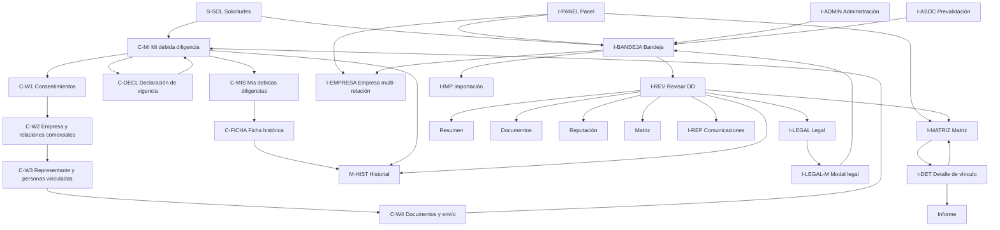

# Debida Diligencia — Matriz de navegación y conexiones

> **Objetivo:** conectar todas las vistas de DD de punta a punta, sin dejar pantallas
> huérfanas ni acciones sin destino.
> **Referencias:** [`11-debida-diligencia.md`](./11-debida-diligencia.md),
> [`14-debida-diligencia-v2-alcance.md`](./14-debida-diligencia-v2-alcance.md).
> **Proyecto Stitch:** `14622015890478812512`.
> **Estado:** especificación de navegación. Stitch es estático; esta matriz es la fuente
> para implementar los enlaces en la aplicación.

## 1. Convención de pantallas

| Código | Pantalla | Ruta / modal |
|---|---|---|
| `C-MI` | Mi debida diligencia | `/dashboard/debida-diligencia` |
| `C-MIS` | Mis debidas diligencias | `/dashboard/mis-debidas-diligencias` |
| `C-W1` | Wizard — Consentimientos | `/dashboard/debida-diligencia/formulario` |
| `C-W2` | Wizard — Empresa y relaciones comerciales | mismo wizard |
| `C-W3` | Wizard — Representante y personas vinculadas | mismo wizard |
| `C-W4` | Wizard — Documentos y envío | mismo wizard |
| `C-DECL` | Declaración jurada de vigencia | `/dashboard/debida-diligencia/declaracion-vigencia` |
| `C-FICHA` | Ficha de DD histórica | `/dashboard/mis-debidas-diligencias` |
| `I-PANEL` | Panel de Debida Diligencia | `/dashboard/debida-diligencia` |
| `I-BANDEJA` | Bandeja de Debida Diligencia | `/dashboard/debida-diligencia/bandeja` |
| `I-EMPRESA` | Empresa — relaciones comerciales | `/dashboard/debida-diligencia/bandeja` |
| `I-REV` | Revisar debida diligencia (modal) | modal sobre bandeja |
| `I-REV-RES` | Revisar — Resumen | tab |
| `I-REV-DOC` | Revisar — Documentos | tab |
| `I-REV-REP` | Revisar — Reputación | tab |
| `I-REV-MAT` | Revisar — Matriz | tab |
| `I-MATRIZ` | Matriz de evaluación DD | `/dashboard/debida-diligencia/matriz` |
| `I-DET` | Detalle de vínculo de matriz | `/dashboard/debida-diligencia/matriz/[id]` |
| `I-IMP` | Importación masiva | modal sobre bandeja |
| `I-REPO` | Repositorio de evidencias | `/dashboard/debida-diligencia/repositorio` |
| `I-REP` | Revisión reputacional | `/dashboard/debida-diligencia/reputacion` |
| `I-LEGAL` | Revisión legal | `/dashboard/debida-diligencia/legal` |
| `I-LEGAL-M` | Revisión legal (modal) | modal sobre bandeja |
| `I-ADMIN` | Administración DD | `/dashboard/debida-diligencia/administracion` |
| `I-ASOC` | Prevalidación de vínculo — Asociados | `/dashboard/debida-diligencia/prevalidacion` |
| `S-SOL` | Solicitudes de alquiler | `/dashboard/solicitudes` |
| `M-HIST` | Historial del expediente | modal |
| `M-DOC` | Vista previa de documento | modal |
| `M-INF` | Informe DD — Vista previa | modal / informe |

Las rutas `repositorio`, `administracion` y `prevalidacion` son destinos V2; todavía no
existen en el código actual.

## 2. Flujo principal

## 3. Portal del Expositor

| Origen | Acción | Destino | Regla |
|---|---|---|---|
| `C-MI` | Comenzar DD | `C-W1` | Solo si no existe expediente |
| `C-MI` | Continuar formulario | `C-W1` / último paso | Solo `borrador` u `observada` |
| `C-MI` | Corregir observaciones | `C-W4` | Wizard inicia en Documentos |
| `C-MI` | Ver documentos enviados | `M-DOC` | Si hay documentos |
| `C-MI` | Ver historial | `M-HIST` | Siempre |
| `C-MI` | Ver informe legal | `M-DOC` | Si `informeLegalUrl` existe |
| `C-MI` | Subir declaración de vigencia | `C-DECL` | Si `puedeRegularizarDeclaracionVigencia` |
| `C-MI` | Iniciar nueva DD | `C-W1` | Si `rechazada` o vencida |
| `C-MI` | Ver detalle por relación | `C-MI` relación | Selecciona la relación comercial |
| `C-MI` | Ver documentos / historial | `M-DOC` / `M-HIST` | Sin salir del portal |
| `C-MIS` | Buscar | `C-MIS` | Filtro por código |
| `C-MIS` | Filtrar por evento/estado | `C-MIS` | Conserva filtros |
| `C-MIS` | Ver detalle | `C-FICHA` | `returnTo` a `C-MIS` |
| `C-MIS` | Ver historial | `M-HIST` | Modal |
| `C-FICHA` | Volver | `C-MIS` | Conserva filtros |
| `C-FICHA` | Ver documentos | `M-DOC` | Solo lectura |
| `C-FICHA` | Ver informe legal | `M-DOC` | Solo lectura |
| `C-W1` | Continuar | `C-W2` | Consentimientos completos |
| `C-W2` | Continuar | `C-W3` | Relación comercial y empresa completas |
| `C-W3` | Continuar | `C-W4` | Personas completas |
| `C-W4` | Enviar a revisión | `C-MI` | Confirmación + expediente `en_revision` |
| `C-W4` | Guardar borrador | mismo paso | Sin perder datos |
| `C-DECL` | Subir declaración | `C-MI` | PDF válido; no cambia fecha original |
| `C-DECL` | Volver | `C-MI` | Sin cambios |

## 4. Backoffice SIG / Logística

### 4.1 Panel

| Origen | Acción | Destino | Regla |
|---|---|---|---|
| `I-PANEL` | Abrir bandeja | `I-BANDEJA` | `dd:revision` |
| `I-PANEL` | Abrir matriz | `I-MATRIZ` | `dd:matriz` |
| `I-PANEL` | Ver ficha | `I-EMPRESA` o `M-HIST` | Si hay expediente |
| `I-PANEL` | Exportar matriz | descarga | Filtros actuales |
| `I-PANEL` | Abrir empresa multi-relación | `I-EMPRESA` | V2 |

### 4.2 Bandeja

| Origen | Acción | Destino | Regla |
|---|---|---|---|
| `I-BANDEJA` | Buscar / filtrar | `I-BANDEJA` | Conserva evento y filtros |
| `I-BANDEJA` | Ver historial | `M-HIST` | Siempre |
| `I-BANDEJA` | Revisar | `I-REV` | Estado revisable |
| `I-BANDEJA` | Abrir empresa | `I-EMPRESA` | Muestra todas las relaciones |
| `I-BANDEJA` | Importación masiva | `I-IMP` | Evento seleccionado |
| `I-BANDEJA` | Exportar | descarga | Filtros actuales |
| `I-BANDEJA` | Abrir matriz del expediente | `I-MATRIZ` / `I-DET` | `dd:matriz` |

### 4.3 Modal Revisar

| Origen | Acción | Destino | Regla |
|---|---|---|---|
| `I-REV` | Cambiar tab | `I-REV-RES` / `DOC` / `REP` / `MAT` | Misma relación comercial |
| `I-REV-RES` | Ver detalle de persona | `I-REV-RES` | Expandir fila |
| `I-REV-DOC` | Ver archivo / versión | `M-DOC` | Documento existente |
| `I-REV-DOC` | Aprobar / observar declaración | `I-REV-DOC` | Revalidación |
| `I-REV-REP` | Ver sustento | `M-DOC` / link | Si hay hallazgos |
| `I-REV-MAT` | Abrir matriz completa | `I-DET` | `returnTo` al modal |
| `I-REV` | Ver historial | `M-HIST` | Siempre |
| `I-REV` | Derivar a Comunicaciones | `I-REP` | Crea casos; no cambia estado |
| `I-REV` | Derivar a Legal | `I-LEGAL` | Solo SIG + DD reforzada + informe |
| `I-REV` | Guardar decisión | `I-BANDEJA` | Vuelve y refresca |
| `I-REV` | Cerrar | `I-BANDEJA` | Descarta cambios no guardados |

### 4.4 Matriz

| Origen | Acción | Destino | Regla |
|---|---|---|---|
| `I-MATRIZ` | Buscar / filtrar | `I-MATRIZ` | Conserva filtros |
| `I-MATRIZ` | Abrir vínculo | `I-DET` | `dd:matriz` |
| `I-MATRIZ` | Exportar | descarga | Seleccionados o filtrados |
| `I-DET` | Volver | `I-MATRIZ` o `I-BANDEJA` | Según `returnTo` |
| `I-DET` | Guardar sección | `I-DET` | Permiso del área |
| `I-DET` | Abrir informe | `M-INF` | Si hay datos |
| `I-DET` | Adjuntar informe/sustento | `I-DET` | Permiso del área |

## 5. Comunicaciones

| Origen | Acción | Destino | Regla |
|---|---|---|---|
| `I-REP` | Seleccionar caso | `I-REP` detalle lateral | No sale de la bandeja |
| `I-REP` | Guardar resultado | `I-REP` | Actualiza caso |
| `I-REP` | Cerrar caso | `I-REP` | Caso cerrado |
| `I-REP` | Ver link de sustento | externo | Solo si existe |
| `I-REP` | Notificar a Logística | `I-BANDEJA` | Campana interna |
| `I-REP` | Volver al expediente | `I-REV-REP` | Solo lectura si no tiene permiso |

## 6. Legal / Compliance

| Origen | Acción | Destino | Regla |
|---|---|---|---|
| `I-LEGAL` | Buscar / paginar | `I-LEGAL` | Conserva filtros |
| `I-LEGAL` | Ver historial | `M-HIST` | Siempre |
| `I-LEGAL` | Revisar | `I-LEGAL-M` | Expediente `en_legal` |
| `I-LEGAL-M` | Ver informe Logística | link / Drive | Si existe |
| `I-LEGAL-M` | Adjuntar informe PDF | `I-LEGAL-M` | Obligatorio para rechazar |
| `I-LEGAL-M` | Aprobar | `I-LEGAL` | Vuelve a SIG |
| `I-LEGAL-M` | Observar | `I-LEGAL` | Solo si se conserva el flujo actual |
| `I-LEGAL-M` | Rechazar | `I-LEGAL` | Relación `NO APTO` |
| `I-LEGAL-M` | Cerrar | `I-LEGAL` | Sin cambios |

## 7. Solicitudes

| Origen | Acción | Destino | Regla |
|---|---|---|---|
| `S-SOL` | Ver DD | `C-MI` / `C-FICHA` | Según rol y expediente |
| `S-SOL` | Filtrar DD APTAS | `S-SOL` | Filtro `dd=aptas` |
| `S-SOL` | Filtrar DD NO APTAS | `S-SOL` | Filtro `dd=no_aptas` |
| `S-SOL` | Revisar solicitud | `S-SOL` detalle | Bloqueado si no es APTO |
| `S-SOL` | Bypass admin | `S-SOL` detalle | Solo `admin:full` |
| `S-SOL` | Ver declaración pendiente | `C-DECL` | Si requiere revalidación |

## 8. Asociados y Administración

| Origen | Acción | Destino | Regla |
|---|---|---|---|
| `I-ASOC` | Validar vínculo | `I-BANDEJA` | Vínculo confirmado |
| `I-ASOC` | Solicitar corrección | `I-ASOC` | Cliente debe corregir |
| `I-ADMIN` | Guardar reglas/plazos | `I-ADMIN` | Permiso `dd:admin` |
| `I-ADMIN` | Editar plantillas/links | `I-ADMIN` | Permiso `dd:admin` |
| `I-ADMIN` | Ver auditoría | `I-ADMIN` | Filtros por usuario/expediente |

## 9. Reglas transversales

1. Toda pantalla que abra un modal debe tener **Cerrar** y volver al origen.
2. Toda pantalla de detalle debe conservar `returnTo` para volver a la bandeja o matriz.
3. El evento activo se conserva en todas las navegaciones.
4. El cliente nunca ve rutas internas de SIG, Comunicaciones o Legal.
5. Los permisos se validan en la ruta y en la acción, no solo en el menú.
6. `NO APTO` debe llevar a la relación que causó el bloqueo, no solo al expediente.
7. `SIN RESPUESTA` debe ofrecer “Iniciar nueva DD” y no permitir corregir la anterior.
8. Las acciones deshabilitadas deben explicar el motivo, no quedar solo en gris.
9. Los filtros de una bandeja se conservan al volver desde un detalle.
10. Ninguna vista debe terminar en una pantalla vacía sin acción de salida.

## 10. Conexiones pendientes de implementar

- `S-SOL → C-MI`: enlace directo desde el bloqueo de DD.
- `I-BANDEJA → I-EMPRESA`: vista multi-relación.
- `I-REV → selector de relación comercial`.
- `I-REP → I-REV-REP`: contexto de relación comercial.
- `I-LEGAL-M → relación comercial`: decisión por relación.
- `I-MATRIZ → I-DET`: `relacionComercialId`.
- `I-ASOC → I-BANDEJA`: prevalidación aprobada.
- `I-ADMIN → reglas/plazos`: efecto real en expedientes.
- `C-MI → C-DECL`: revalidación por relación.
- `M-DOC` y `M-HIST`: apertura desde todas las vistas que los necesiten.

## 11. Limitación de Stitch

El MCP de Stitch no tiene una herramienta para enlazar pantallas ni para crear hotspots.
Las pantallas son estáticas. Esta matriz es la especificación de navegación; los enlaces
reales se implementan en Next.js. Si se requiere un prototipo clickable, se debe generar
aparte en HTML o en la interfaz de Stitch.
