# Debida Diligencia V2 — Diagrama de actividades

> **Fuente:** [14-debida-diligencia-v2-alcance.md](./14-debida-diligencia-v2-alcance.md),
> [15-debida-diligencia-navegacion.md](./15-debida-diligencia-navegacion.md) y
> [11-debida-diligencia.md](./11-debida-diligencia.md).
> **Diagrama editable:** [diagramas/debida-diligencia-v2-actividades.mmd](./diagramas/debida-diligencia-v2-actividades.mmd).
> **Alcance:** proceso completo por empresa y relación comercial, incluyendo
> prevalidación, wizard, SIG, Comunicaciones, Legal, evidencias, plazos, bloqueo global,
> informe y revalidación.
> **Imagen:** [JPG](./diagramas/debida-diligencia-v2-actividades.jpg) ·
> [PNG](./diagramas/debida-diligencia-v2-actividades.png) ·
> [Mermaid](./diagramas/debida-diligencia-v2-actividades.mmd).

## 1. Diagrama de actividades

```mermaid
flowchart TD
  classDef start fill:#1B365D,color:#FFFFFF,stroke:#1B365D,stroke-width:2px
  classDef decision fill:#FFF7E6,color:#0F172A,stroke:#B8860B,stroke-width:2px
  classDef success fill:#DCFCE7,color:#166534,stroke:#16A34A,stroke-width:2px
  classDef warning fill:#FEF3C7,color:#92400E,stroke:#D97706,stroke-width:2px
  classDef block fill:#FEE2E2,color:#991B1B,stroke:#DC2626,stroke-width:2px
  classDef external fill:#E0F2FE,color:#0C4A6E,stroke:#0284C7,stroke-width:2px
  classDef system fill:#F1F5F9,color:#0F172A,stroke:#64748B,stroke-width:1px

  subgraph CLIENTE["Cliente - Portal del Expositor"]
    direction TB
    C0([Inicio: empresa solicita participar]):::start
    C1[Ingresa al portal con evento activo]:::system
    C2{¿Tiene cuenta vinculada a empresa?}:::decision
    C3[Completa perfil de empresa]:::system
    C4{¿Existe DD vigente?}:::decision
    C5{¿Es la misma relación comercial?}:::decision
    C6[Descarga y sube declaración jurada de vigencia]:::system
    C7{¿Declaración aprobada?}:::decision
    C8[Corrige declaración]:::warning
    C9[Reutiliza la DD para el evento]:::success
    C10[Wizard DD V2]:::start
    C11[Paso 1: consentimientos ARCO y DD reforzada]:::system
    C12[Paso 2: empresa y relaciones comerciales]:::system
    C13[Paso 3: representante y personas vinculadas]:::system
    C14[Paso 4: documentos base y declaración de veracidad]:::system
    C15[Envía DD a revisión]:::start
    C16{¿SIG solicita corrección?}:::decision
    C17[Corrige documentos u observaciones]:::warning
    C18[Inicia nueva DD si venció o fue rechazada]:::warning

    C0 --> C1
    C1 --> C2
    C2 -->|No| C3
    C3 --> C4
    C2 -->|Sí| C4
    C4 -->|No| C10
    C4 -->|Sí| C5
    C5 -->|No, cambió el vínculo| C10
    C5 -->|Sí| C6
    C6 --> C7
    C7 -->|No| C8
    C8 --> C6
    C7 -->|Sí| C9
    C9 --> SOL0
    C10 --> C11
    C11 --> C12
    C12 --> C13
    C13 --> C14
    C14 --> C15
    C15 --> A1
    C16 -->|Sí| C17
    C17 --> C15
    C16 -->|No| FIN1
    C18 --> C10
  end

  subgraph ASOCIADOS["Asociados"]
    direction TB
    A1[Recibe relaciones comerciales declaradas]:::system
    A2{¿El tipo de relación comercial es correcto?}:::decision
    A3[Registra observación y devuelve al cliente]:::warning
    A4[Valida el vínculo y lo envía a SIG]:::success

    A1 --> A2
    A2 -->|No| A3
    A3 --> C17
    A2 -->|Sí| A4
  end

  subgraph SIG["SIG - Logística"]
    direction TB
    SIG1[Recibe la relación comercial para evaluación]:::system
    SIG2[Valida datos, documentos y personas]:::system
    SIG3{¿Ámbito del sujeto evaluado?}:::decision
    SIG4["Criterios NACIONALES:<br/>INDECOPI · OEFA · corrupción/soborno/lavado<br/>PEPs/PRP · central de riesgo · bancarizado<br/>conflicto de interés"]:::external
    SIG5["Criterios EXTRANJEROS:<br/>OFAC · ONU · OpenSanctions · OhMyFin<br/>Canadá · Europa · UK · Australia<br/>Banco Mundial · INTERPOL · DEA"]:::external
    SIG6[Registra evidencia por cada campo aplicable]:::system
    SIG7[Analiza resultados y evidencias]:::system
    SIG8[Deriva nombres, cargos y sitio web a Comunicaciones]:::system
    SIG9[Recibe y evalúa el resultado de Comunicaciones]:::system
    SIG10{¿Requiere debida diligencia reforzada?}:::decision
    SIG11[Conclusión SIG: SIN OBSERVACIONES o ACEPTADO]:::success
    SIG12[Adjunta informe y sustento, y deriva a Legal]:::warning
    SIG13[Documentación observada: devuelve al cliente]:::warning

    SIG1 --> SIG2
    SIG2 --> SIG3
    SIG3 -->|Nacional| SIG4
    SIG3 -->|Extranjera| SIG5
    SIG4 --> SIG6
    SIG5 --> SIG6
    SIG6 --> SIG7
    SIG7 --> SIG8
    SIG8 --> COM1
    COM7 --> SIG9
    SIG9 --> SIG10
    SIG10 -->|No| SIG11
    SIG10 -->|Sí| SIG12
    SIG12 --> LEG1
    SIG9 -->|Falta documento o evidencia| SIG13
    SIG13 --> C16
  end

  subgraph COMUNICACIONES["Comunicaciones"]
    direction TB
    COM1[Recibe nombres, cargos, nacionalidad y sitio web]:::system
    COM2[Revisa entrevistas, prensa, sanciones y fuentes]:::system
    COM3{¿Resultado reputacional?}:::decision
    COM4[Sin hallazgos: conclusión sin observaciones]:::success
    COM5[Con hallazgos: observación y link de sustento]:::warning
    COM6[Requiere información adicional]:::warning
    COM7[Devuelve resultado a SIG]:::system

    COM1 --> COM2
    COM2 --> COM3
    COM3 -->|Sin hallazgos| COM4
    COM3 -->|Con hallazgos| COM5
    COM3 -->|Requiere información| COM6
    COM4 --> COM7
    COM5 --> COM7
    COM6 --> COM7
  end

  subgraph LEGAL["Legal - Compliance"]
    direction TB
    LEG1[Recibe solo relaciones derivadas por SIG]:::system
    LEG2{Decisión legal}:::decision
    LEG3[Adjunta informe legal PDF obligatorio]:::warning
    LEG4[Devuelve la relación a SIG]:::success
    LEG5[Marca la relación como NO APTO]:::block

    LEG1 --> LEG2
    LEG2 -->|Aprueba| LEG4
    LEG2 -->|Rechaza| LEG3
    LEG3 --> LEG5
    LEG4 --> SIG11
  end

  subgraph SISTEMA["Sistema - estados, plazo y bloqueo"]
    direction TB
    S0[Configura plazo, reglas, plantillas y links]:::system
    S1[Activa plazo de respuesta]:::warning
    S2{¿Responde dentro del plazo?}:::decision
    S3[Cierra la relación como SIN RESPUESTA]:::block
    S4[Continúa la revisión]:::system
    S5[Calcula resultado final por relación]:::system
    S6{¿Alguna relación quedó NO APTO?}:::decision
    S7[Bloquea toda la empresa]:::block
    S8[Empresa habilitada según cada relación]:::success
    S9[Genera informe por relación comercial]:::system
    S10[Vista previa y PDF con anexos]:::success
    S11[(Auditoría: usuario, fecha, acción y evidencia)]:::system
    S12[Exporta matriz de 54 columnas]:::system

    S0 -.-> S1
    S1 --> S2
    S2 -->|No| S3
    S2 -->|Sí| S4
    S3 --> C18
    S4 --> S5
    S5 --> S6
    S6 -->|Sí| S7
    S6 -->|No| S8
    S5 --> S9
    S9 --> S10
    S7 --> S11
    S8 --> S11
    S10 --> S11
    S11 -.-> S12
  end

  subgraph SOLICITUDES["Solicitudes"]
    direction TB
    SOL0[Solicitud de reserva o participación]:::start
    SOL1{¿Empresa bloqueada o relación no apta?}:::decision
    SOL2[Bloquea la revisión y muestra el motivo]:::block
    SOL3[Permite reservar; solo avanza si la relación está APTO]:::warning
    SOL4[Relación APTO y vigente]:::success

    SOL0 --> SOL1
    SOL1 -->|Sí| SOL2
    SOL1 -->|No| SOL3
    SOL3 --> SOL4
    SOL4 --> S5
    SOL2 --> C18
  end

  subgraph EXTERNO["Registro externo"]
    direction TB
    EXT1[Importa Excel/CSV de resultados]:::external
    EXT2[Registro externo de empresas]:::external
    EXT3[Distingue APTO, APTO CON OBSERVACIONES, NO APTO y PENDIENTE]:::external

    EXT1 --> EXT2
    EXT2 --> EXT3
    EXT3 -.-> SOL1
  end

  C9 --> SOL0
  A4 --> SIG1
  SIG11 --> FIN1
  LEG5 --> FIN2
  FIN1[Resultado final por relación]:::success
  FIN2[Resultado final NO APTO de la relación]:::block
  FIN1 --> S5
  FIN2 --> S5
  S5 --> FIN3
  FIN3{¿Todas las relaciones están resueltas?}:::decision
  FIN3 -->|No| SIG1
  FIN3 -->|Sí| S6
  S6 --> RPT1
  RPT1[Informe consolidado por relación]:::system
  RPT1 --> S9
  S7 --> C18
  S3 --> C18


```

## 2. Lectura del diagrama

- **Una empresa puede tener varias relaciones comerciales.** Cada relación se evalúa y se resuelve por separado.
- **Las personas son de la empresa**, pero se replican como sujetos evaluados dentro de cada relación comercial. No tienen un resultado final independiente.
- **El ámbito se decide por sujeto:** una empresa nacional puede tener un representante extranjero; ese sujeto usa criterios extranjeros y los demás criterios nacionales.
- **Criterios nacionales:** INDECOPI, OEFA, corrupción/soborno/lavado, PEPs/PRP, central de riesgo, bancarizado y conflicto de interés.
- **Criterios extranjeros:** OFAC, Naciones Unidas, OpenSanctions, OhMyFin, sanciones de Canadá, Europa, Reino Unido, Australia, Banco Mundial, INTERPOL y DEA.
- **N.A. exime de evidencia.** Todo campo aplicable exige archivo y/o link.
- **Comunicaciones es obligatorio para todas las relaciones.** Su resultado alimenta la conclusión de SIG, pero la decisión final de la relación la toma SIG.
- **Legal solo recibe relaciones derivadas por SIG** cuando existe REQUIERE DEBIDA DILIGENCIA REFORZADA y se adjuntó informe y sustento.
- **Legal aprueba:** vuelve a SIG. **Legal rechaza:** la relación queda NO APTO.
- **NO APTO en cualquier relación bloquea toda la empresa.**
- **La vigencia es de 6 meses** desde la decisión final de la relación.
- **La revalidación** solo aplica a la misma relación comercial, con declaración de vigencia. Si cambia la relación, se inicia una nueva evaluación.
- **El plazo es configurable.** Si vence sin respuesta, la relación cierra como SIN RESPUESTA y el cliente debe iniciar una nueva DD.
- **El informe se genera por relación comercial** con sus personas, evidencias, observaciones, conclusiones y anexos.
- **Solicitudes** valida la relación solicitada y el bloqueo global; no solo el estado general de la empresa.
- **Toda decisión y cambio de estado** queda en auditoría.
