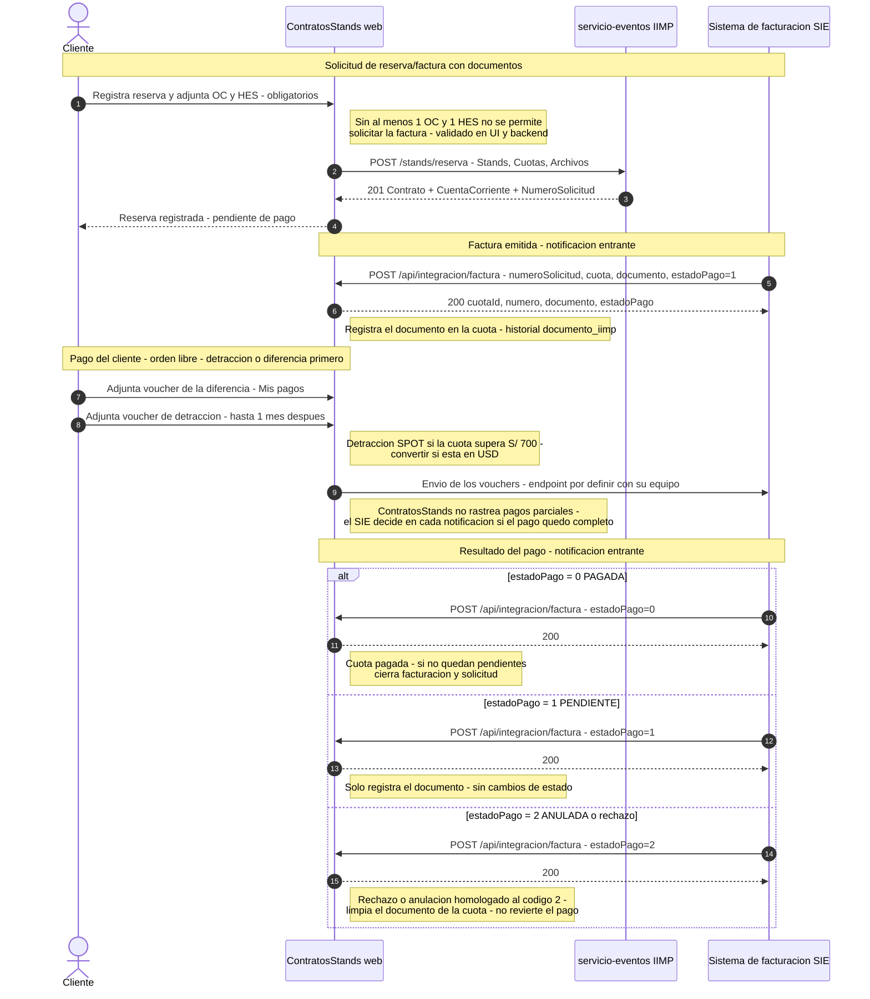
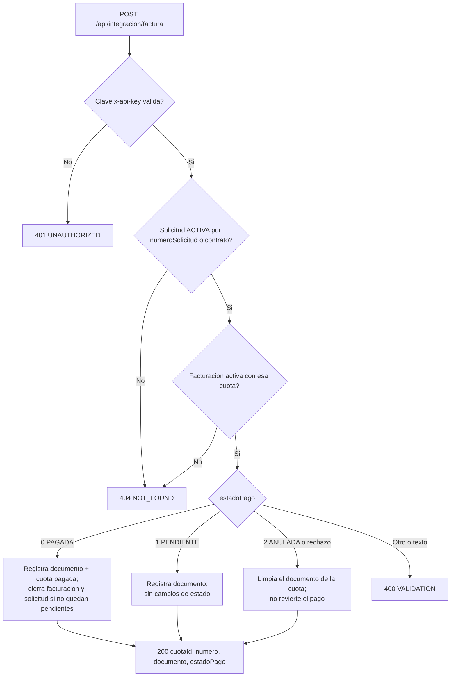

# API de notificación de facturación — ContratosStands (IIMP)

> Guía de integración para el **sistema de facturación (SIE)**.
> Servicio para registrar, contra una **cuota** de una reserva de stands, el
> **nombre del documento emitido** (factura/boleta) y su **estado** codificado
> (`0` PAGADA · `1` PENDIENTE · `2` ANULADA).
> **No se envían archivos**: solo el nombre del documento y el estado.
> **Documento marco del acuerdo (flujo y responsabilidades por lado):** `acuerdo-integracion-facturacion.md`

## 0. Flujo de comunicación (extremo a extremo)

**Diagramas de esta guía** (carpeta de entrega):

| Diagrama | Notación | Archivo |
|---|---|---|
| Secuencia (abajo) | UML — Mermaid | `diagrama-1-secuencia.png` |
| Actividades | **UML con carriles** (Cliente / ContratosStands / SIE), rombos de decisión; cubre **todas las casuísticas** (A1–C8) | `diagrama-2-actividades-uml.png` (fuente: `diagramas/actividades-uml.puml`) |
| Flujo del endpoint (§6) | Diagrama de flujo — Mermaid | `diagrama-3-flujo.png` |



**Pasos**

| # | Quién → Quién | Medio | Estado |
|---|---|---|---|
| 1 | Cliente → ContratosStands | Solicitud con **OC y HES de la 1ª cuota obligatorios** (opcionales en cuotas 2–3; la detracción y la diferencia se adjuntan después, al pagar) | Implementado |
| 2 | ContratosStands → servicio-eventos | `POST /stands/reserva` con `Archivos` (ver doc de reserva del IIMP) | Implementado |
| 3 | **SIE → ContratosStands** | **`POST /api/integracion/factura`** — factura emitida (nombre del documento + estado) | **Esta guía** |
| 4 | Cliente → ContratosStands | Adjunta los **vouchers** en "Mis pagos": diferencia/detracción (orden libre; detracción **hasta 1 mes después**) o **pago total** (`PAGO_TOTAL`) | Implementado |
| 5 | ContratosStands → SIE | Envío del voucher | **Pendiente**: su equipo define el endpoint receptor |
| 6 | **SIE → ContratosStands** | **`POST /api/integracion/factura`** — resultado del pago (`0`/`1`; `2` si se anula) | **Esta guía** |

\* Paso 5 con asterisco: pendiente de coordinación (ver §9).

### Reglas y casuísticas del proceso

**A. Solicitud de factura (requisito OC + HES)**

| # | Casuística | Comportamiento |
|---|---|---|
| 1 | Cliente adjunta la **OC y HES de la primera cuota** (cada cuota puede llevar sus propias OC/HES; en las cuotas 2 y 3 son opcionales) y solicita la reserva/factura | ContratosStands envía `POST /stands/reserva` con `Archivos`. El SIE procesa de forma **asíncrona** y notifica la factura emitida (documento + `estadoPago: 1`) |
| 2 | Cliente intenta solicitar **sin OC/HES en la primera cuota** | No permitido: la **primera cuota** requiere al menos 1 OC y 1 HES (validación en UI y backend; cuentan los documentos generales sin cuota) |
| 3 | Cliente adjunta la **valorización / cotización** del servicio | Opcional en cualquier cuota (`VALORIZACION_COTIZACION`, v5; sin cuota = de toda la cuenta) |

**B. Pago de la cuota (vouchers de detracción y de diferencia)**

| # | Casuística | Comportamiento |
|---|---|---|
| 3 | Cuota **> S/ 700**: pago del **resto de la cuota** (diferencia = total − detracción) | El cliente adjunta su voucher (`DIFERENCIA`) y ContratosStands lo envía al SIE. El **orden es libre**: también puede pagar primero la detracción |
| 4 | **Detracción (SPOT 10 %)** | Aplica si la cuota supera **S/ 700** (convertir si la cuota está en USD). Puede pagarse **hasta 1 mes después** del resto, y el **orden es libre** (detracción o diferencia primero) |
| 5 | **Múltiples vouchers** por cuota | Cada envío se notifica al SIE. **ContratosStands no trackea parciales**: el SIE indica, en cada notificación (`estadoPago`), si el pago quedó completo (`0`) o sigue pendiente (`1`) |
| 6 | Pago **sin detracción** (cuota ≤ S/ 700) | **Un solo pago**: el cliente adjunta la constancia del **pago total** (`PAGO_TOTAL`; sin cuota = total de la cuenta); aplica el mismo circuito de envío y notificación |

**C. Rechazo / anulación del documento**

| # | Casuística | Comportamiento |
|---|---|---|
| 7 | El SIE **rechaza o anula** la factura | Notifica por esta API con `estadoPago: 2` (ANULADA) — código **homologado** con la declaración del SIE (no existe un código separado de rechazo) |
| 8 | ContratosStands solicita un **rechazo** al SIE | Comunicación **bidireccional**: ContratosStands enviará la solicitud de rechazo por la API del SIE (canal por definir, ver §9) |

## 1. Ambientes

| Ambiente | URL base |
|---|---|
| Producción | `https://ecommerce.sistemasiimp.org.pe` |
| Local / desarrollo | `http://localhost:3001` (solo pruebas internas; en local no se exige clave) |
| **Prueba en curso (túnel)** | `https://troops-fast-authentic-soma.trycloudflare.com` — túnel al local del equipo ContratosStands. **URL efímera**: cambia si el túnel se reinicia. En este ambiente **no se exige `x-api-key`** |

Endpoint (los dos ambientes):

```
POST {URL base}/api/integracion/factura
Content-Type: application/json
```

## 2. Autenticación

```
x-api-key: <clave compartida>
```

- La clave se entrega por canal seguro (misma clave del Sistema de Montaje).
- Clave ausente o inválida → `401`. En el ambiente local/túnel **no** se exige.

## 3. Request

```json
{
  "numeroSolicitud": "CTRS-dbef0d24ff1246b1b419edd05",
  "cuota": 1,
  "documento": "F001-1234.pdf",
  "estadoPago": 1
}
```

| Campo | Tipo | Obligatorio | Descripción |
|---|---|---|---|
| `numeroSolicitud` | string | Uno de los dos | `NumeroSolicitud` devuelto por la reserva (`POST /stands/reserva`) |
| `contrato` | string | Uno de los dos | Alternativa: `Contrato` devuelto por la reserva (ej. `0000000008`) |
| `cuota` | number | Sí | Número de cuota de la cuenta (**1 a 3**, en el orden de `Cuotas` de la reserva). El plan tiene **hasta 3 cuotas** y la notificación es **por cuota** |
| `documento` | string | Sí | **Nombre del documento** emitido (máx. 250 caracteres). No es el archivo |
| `estadoPago` | number | Sí | Código del estado: `0` PAGADA · `1` PENDIENTE · `2` ANULADA |

### Códigos de `estadoPago`

| Código | Estado | Cuándo lo envía el SIE |
|---|---|---|
| `0` | PAGADA | El documento quedó con saldo 0 en SAP (pago vinculado) |
| `1` | PENDIENTE | El documento se emitió y aún no está pagado. Incluye **pagos parciales**: p. ej. pagada la diferencia y pendiente la detracción (la cuota se cierra recién con `0`) |
| `2` | ANULADA | El documento se anuló en el SIE y la cuota no tiene otro documento vigente |

En **cada notificación** envíen `documento` **y** `estadoPago` vigente (en la
emisión de la factura, el estado natural es `1` PENDIENTE).

## 4. Respuesta exitosa (200)

```json
{
  "success": true,
  "data": {
    "cuotaId": "571040d6-14b3-4c03-8820-73271423ba0c",
    "numero": 1,
    "documento": "F001-1234.pdf",
    "estadoPago": 1
  }
}
```

## 5. Errores

| HTTP | `code` | Cuándo |
|---|---|---|
| 400 | `VALIDATION` | JSON inválido; falta `numeroSolicitud`/`contrato`; `cuota` no es entero ≥ 1; `documento` vacío o > 250; `estadoPago` distinto de `0`, `1` o `2` (también si viene como texto) |
| 401 | `UNAUTHORIZED` | Clave `x-api-key` ausente o inválida |
| 404 | `NOT_FOUND` | No existe solicitud **activa** para ese `numeroSolicitud`/`contrato` (si la reserva fue anulada, también responde 404); sin facturación activa; la facturación no tiene esa cuota |
| 500 | `INTERNAL` | Error interno |

```json
{ "success": false, "error": { "code": "VALIDATION", "message": "estadoPago debe ser 0 (PAGADA), 1 (PENDIENTE) o 2 (ANULADA)" } }
```

```json
{ "success": false, "error": { "code": "NOT_FOUND", "message": "La facturacion no tiene la cuota 3" } }
```

## 6. Diagrama de flujo — Qué hace ContratosStands con la notificación



| Código | Efecto |
|---|---|
| `0` PAGADA | La cuota pasa a **pagada**; si no quedan cuotas pendientes, la facturación de la reserva pasa a `pagado` y la solicitud también |
| `1` PENDIENTE | Solo registra el documento; no cambia estados |
| `2` ANULADA | Limpia el documento de la cuota (vuelve a **pendiente de documento**); no revierte estados de pago |

Cada notificación además:
1. Guarda el **nombre del documento** en la cuota (visible para el backoffice y el cliente).
2. Registra el movimiento en el historial de facturación (firmado por `iimp`).

La llamada puede repetirse: cada envío actualiza el documento y el estado con lo
último notificado (no hay `Idempotency-Key`).

## 7. Ejemplos

```bash
# [Paso 3] Factura emitida (pendiente de pago)
curl -X POST https://ecommerce.sistemasiimp.org.pe/api/integracion/factura \
  -H "x-api-key: $CLAVE_COMPARTIDA" \
  -H "Content-Type: application/json" \
  -d '{"numeroSolicitud":"CTRS-dbef0d24ff1246b1b419edd05","cuota":1,"documento":"F001-1234.pdf","estadoPago":1}'
```

```bash
# [Paso 6] Resultado del pago (saldo 0 en SAP)
curl -X POST https://ecommerce.sistemasiimp.org.pe/api/integracion/factura \
  -H "x-api-key: $CLAVE_COMPARTIDA" \
  -H "Content-Type: application/json" \
  -d '{"numeroSolicitud":"CTRS-dbef0d24ff1246b1b419edd05","cuota":1,"documento":"F001-1234.pdf","estadoPago":0}'
```

```bash
# Prueba en curso contra el túnel (sin clave) — usar la URL vigente de §1
curl -X POST https://troops-fast-authentic-soma.trycloudflare.com/api/integracion/factura \
  -H "Content-Type: application/json" \
  -d '{"contrato":"0000000008","cuota":1,"documento":"PRUEBA.pdf","estadoPago":1}'
```

## 8. Estado de la verificación

Verificado por el equipo ContratosStands contra el túnel de pruebas (14-10-2026):

| Prueba | Resultado |
|---|---|
| `200` — `estadoPago: 1` (PENDIENTE): documento registrado en la cuota, estado **sin cambios** | ✅ |
| `200` — `estadoPago: 0` (PAGADA) **end-to-end** (reserva vigente, contrato `0000000008`): cuota pagada + facturación y solicitud cerradas | ✅ |
| `200` — `estadoPago: 2` (ANULADA): documento limpiado de la cuota | ✅ |
| `200` — el movimiento queda en el historial de facturación (acción `documento_iimp`, firmado por `iimp`) | ✅ |
| `400` — `estadoPago: 3` fuera de rango o enviado como texto (`"PAGADO"`) | ✅ |
| `404` — `contrato` inexistente o reserva anulada | ✅ |

## 9. Pendientes por coordinar

> **Homologado (14-10-2026):** el rechazo del documento se comunica con `estadoPago: 2`
> (ANULADA), según la declaración del SIE (no hay código adicional de rechazo).
> La validación de **OC/HES obligatorios** quedó implementada (UI + backend).

| # | Tema | Responsable |
|---|---|---|
| 1 | Endpoint para **recibir el voucher** de pago (paso 5 del flujo). Hoy ContratosStands registra los vouchers como archivos `DETRACCION`/`DIFERENCIA`/`PAGO_TOTAL` en la cuenta corriente (`/stands/archivos`); confirmar si el SIE los consume por esa vía o exige un endpoint propio | Equipo de facturación del IIMP |
| 2 | `2` ANULADA después de PAGADA: confirmar si debe **revertir el estado de pago** de la cuota a pendiente (hoy solo limpia el documento) | Equipo de facturación del IIMP |
| 3 | **Solicitud de rechazo** (ContratosStands → SIE): definir el canal/endpoint del SIE para que nuestro lado envíe su rechazo (bidireccional) | Equipo de facturación del IIMP |
| 4 | Clave compartida en producción (`x-api-key`) | Se entrega por canal seguro |

## 10. Notas

- La notificación es **por cuota**: el plan de la reserva puede tener **hasta 3 cuotas**; cada una se notifica con su número. La reserva se registra **una sola vez** (desde la cuota que la dispara).
- Tipos de archivo de la cuenta corriente (v5): `OC`, `HES`, `DETRACCION`, `DIFERENCIA`, `PAGO_TOTAL` y `VALORIZACION_COTIZACION`. En la UI de "Mis pagos", `PAGO_TOTAL` es **excluyente** con `DETRACCION`/`DIFERENCIA` de una misma cuota (la lista de tipos es dinámica).
- El `documento` es solo el **nombre**; el archivo no se transfiere por esta vía.
- Si el documento se reemite, basta con enviarlo de nuevo (reemplaza el anterior).
- `estadoPago` es **numérico** (`0`/`1`/`2`); el texto (`"PAGADO"`) responde `400`.
- Para dudas de integración: equipo de Sistemas TI del IIMP.
