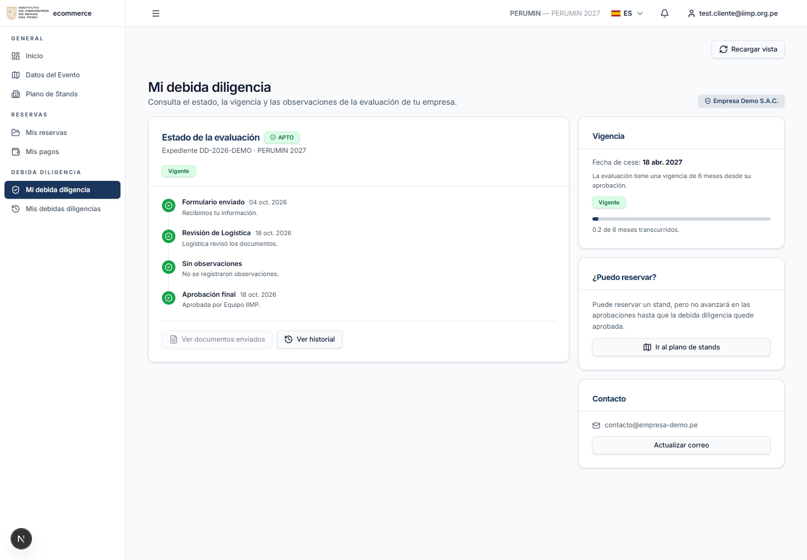
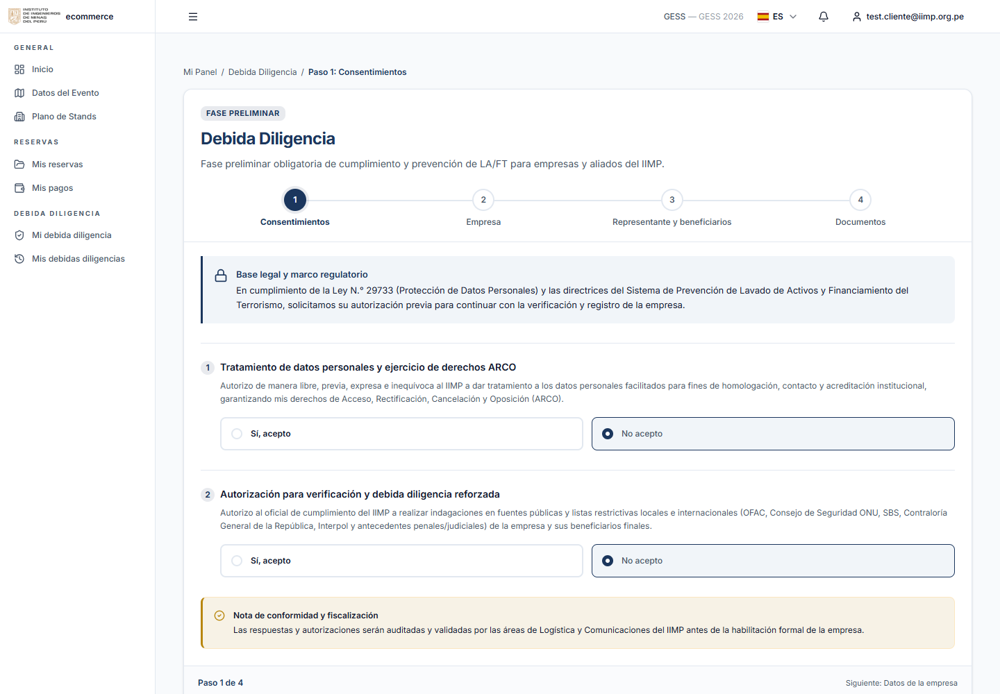
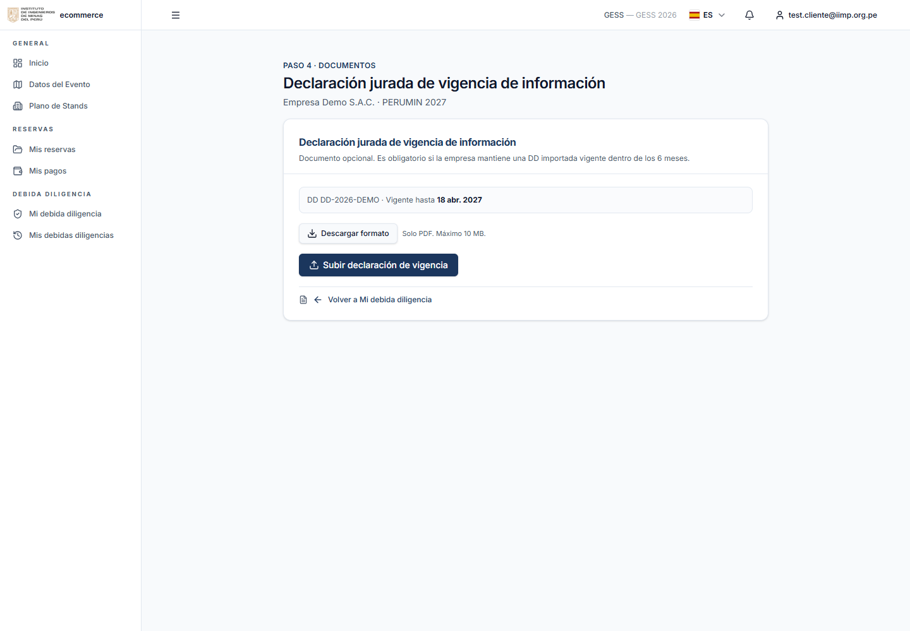

# Manual de Debida Diligencia — Portal del Expositor

> **Versión:** 1.0  
> **Audiencia:** Empresas exhibidoras.  
> **Alcance:** Formulario, documentos, vigencia y revalidación de la Debida Diligencia.  
> **Idiomas:** el portal puede verse en español e inglés con el selector ES/EN de la cabecera.  
> **Nota:** las capturas usan datos de ejemplo y no corresponden a expedientes reales.

---

## 1. ¿Qué es la Debida Diligencia?

La **Debida Diligencia (DD)** es la evaluación de cumplimiento y prevención de LA/FT que el IIMP realiza a las empresas que participan en sus eventos.

Como empresa, la DD te permite:

- Acreditar la información de tu empresa y su representante legal.
- Registrar a tus beneficiarios finales.
- Cargar los documentos societarios y de identidad requeridos.
- Conocer el estado de tu evaluación y su vigencia.
- Regularizar tu situación cuando ya cuentas con una evaluación aprobada de otro evento.

La DD es un requisito del proceso. **No reemplaza** la solicitud de stand ni el contrato de exhibición.

> Una DD aprobada tiene una vigencia de **6 meses** desde la aprobación. Al vencer, deberás iniciar una nueva evaluación.

---

## 2. Acceso y requisitos

Ingresa con tu cuenta del Portal del Expositor y selecciona el evento en **Selecciona tu evento**.

En el menú **Debida Diligencia** encontrarás:

- **Mi debida diligencia:** estado, vigencia, observaciones y acciones pendientes.
- **Mis debidas diligencias:** historial de todas las evaluaciones de tu empresa.

Para completar el formulario necesitas:

- Una cuenta vinculada a una empresa. Si no lo está, el portal te pedirá completar los datos de empresa en el perfil.
- Un evento activo.
- Los documentos de tu empresa y representante legal.

Si no ves estas opciones en el menú, solicita apoyo a la Mesa de Ayuda del IIMP.

  
*Figura 1 — Resumen de tu Debida Diligencia, con estado, vigencia y acciones.*

---

## 3. Antes de empezar: evento y datos de tu empresa

La DD se trabaja con el **evento activo**. El evento define el contexto de tu participación, pero no cambia por sí solo la validez de una evaluación ya aprobada.

Si tu empresa ya tiene una DD aprobada y vigente de **otro evento**, el portal puede mostrarte un aviso con la opción de subir la **Declaración jurada de vigencia de información**. En ese caso no necesitas iniciar una nueva evaluación desde cero.

Antes de abrir el formulario, revisa que los datos de tu empresa estén actualizados: razón social, RUC, representante legal y datos de contacto.

---

## 4. Formulario paso a paso

El formulario tiene **4 pasos**. Puedes guardar un borrador y continuar después.

Solo puedes avanzar a un paso cuando los anteriores están completos. Los títulos de los pasos te permiten volver a los pasos ya completados.

### Paso 1 — Consentimientos

Debes aceptar:

- El **tratamiento de datos personales y derechos ARCO**.
- La **verificación en fuentes públicas y listas restrictivas** para la debida diligencia.

El botón **Continuar** permanece deshabilitado hasta aceptar ambas autorizaciones. También se solicita la declaración de veracidad de la información.

### Paso 2 — Empresa

Completa o confirma:

- **Tipo de relación comercial:** exhibidor, auspiciador, asociado adherente, media partner, proveedor, alquileres u otro.
- **Razón social y RUC** (prellenados desde la ficha de tu empresa).
- **País de constitución.**
- **Actividad económica** del catálogo del IIMP.
- **Sitio web** y **correo del representante legal.**

Si eliges la actividad **Otro**, indica cuál en el campo adicional.

### Paso 3 — Representante y beneficiarios

Registra al **representante legal** con:

- Nombre completo.
- Tipo y número de documento.
- Nacionalidad.

Agrega a los **beneficiarios finales** con participación de **10% o más**. Para cada uno indica nombre, documento, nacionalidad y porcentaje. El documento se puede validar contra RENIEC o SUNAT para autocompletar el nombre.

> La nacionalidad acepta letras, espacios, apóstrofes, puntos y guiones. No uses solo números.

### Paso 4 — Documentos y envío

Carga los **cuatro documentos obligatorios**:

1. **Ficha RUC** o equivalente para empresas extranjeras.
2. **Vigencia de poderes** del representante legal, con antigüedad menor a 3 meses.
3. **Documento de identidad del representante legal**, con ambos lados en un solo archivo.
4. **Declaración jurada de compromiso de actualización de información**, en el formato oficial firmado.

Formatos y límites:

- **PDF, JPG o PNG**; la declaración jurada también admite el **DOCX oficial**.
- Máximo **10 MB** por archivo.
- No se aceptan Word, Excel ni PowerPoint para los demás documentos.
- Cada archivo se valida por extensión, tamaño y contenido real.

Cuando el IIMP te solicite documentos adicionales, aparecerán en este paso:

- **Declaración jurada de vigencia de información.**
- **Adjunto PDF adicional.**

Antes de enviar, revisa el resumen, acepta la declaración de veracidad y confirma el envío. El expediente pasa a **En revisión** y se notifica al contacto declarado.

  
*Figura 2 — Formulario de la empresa: consentimientos y pasos de la evaluación.*

### 4.1 Guardar un borrador

Puedes usar **Guardar borrador** en cualquier paso. Al volver a ingresar, el formulario recupera la información y las autorizaciones ya guardadas.

### 4.2 Corregir documentos observados

Si el equipo de cumplimiento solicita correcciones:

1. Ingresa a **Mi debida diligencia** y revisa las observaciones.
2. Abre el formulario: se posiciona en el paso de documentos y resalta los archivos observados.
3. Usa **Subir nueva versión** en cada documento marcado.
4. Vuelve a enviar. No se permite reenviar mientras quede un documento observado sin reemplazar.

Las versiones anteriores se conservan y pueden consultarse en el historial del documento.

---

## 5. Después de enviar

Cuando envías el formulario:

- El expediente queda **En revisión**.
- El equipo de cumplimiento del IIMP verifica la información y los documentos.
- Si todo está conforme, la DD se aprueba y queda vigente por **6 meses**.
- Si se requiere alguna corrección, recibirás las observaciones en **Mi debida diligencia**.
- Si la evaluación no es aprobada, el portal mostrará el estado y el motivo correspondiente.

Mientras la DD está pendiente, puedes consultar el estado, pero no se considera aprobada. La aprobación no es inmediata al enviar el formulario.

---

## 6. Estados, vigencia y revalidación

### 6.1 Estados que verás en el portal

| Estado | Significado |
|---|---|
| **Borrador** | Iniciaste el formulario y aún no lo enviaste. |
| **Pendiente** | El expediente está registrado, pero todavía no ingresó a revisión. |
| **En revisión** | El equipo de cumplimiento está evaluando tu expediente. |
| **Observada** | Se solicitaron correcciones. Revisa **Mi debida diligencia**. |
| **Aprobada / APTO** | La evaluación fue aprobada y tienes vigencia de 6 meses. |
| **Rechazada / NO APTO** | La evaluación concluyó negativamente. Revisa el motivo en el portal. |

### 6.2 Vigencia

- La vigencia empieza con la **aprobación** de la DD.
- Dura **6 meses**.
- Se considera **por vencer** cuando faltan **30 días o menos**.
- Una DD vencida no te habilita a avanzar. Debes iniciar una nueva evaluación.

Si la DD fue rechazada o está vencida, el portal te ofrecerá iniciar una nueva desde **Mi debida diligencia**.

### 6.3 Revalidación para otro evento

Si tu empresa tiene una DD aprobada y vigente de **otro evento**, puedes reutilizarla regularizando la declaración de vigencia.

1. En **Mi debida diligencia**, revisa el aviso que indica el evento de tu DD vigente y el evento activo.
2. Pulsa **Subir Declaración de vigencia de información**.
3. Descarga el formato oficial, fírmalo y cárgalo en **PDF**.
4. El IIMP revisará la declaración.
5. Si se aprueba, la DD queda utilizable para el evento activo. Si se observa, deberás subir una nueva versión.

La revalidación **no crea una nueva DD**, no cambia la fecha de aprobación original y no modifica la fecha de vencimiento. Solo valida la declaración de vigencia.

  
*Figura 3 — Carga de la Declaración de vigencia para una DD de otro evento.*

> Si la declaración está pendiente u observada, tu empresa puede aparecer como **APTO pendiente de declaración** y no podrá avanzar hasta que sea aprobada.

---

## 7. Notificaciones y privacidad

- Recibirás correos cuando tu expediente se envíe, se observe, se apruebe o se rechace, según la etapa.
- En **Mi debida diligencia** puedes consultar el estado, la vigencia y las observaciones.
- Solo los equipos autorizados del IIMP acceden a la información y documentación de tu empresa.
- Tus documentos conservan un historial de versiones para consulta y sustento.

---

## 8. Preguntas frecuentes

**¿La DD es lo mismo que la solicitud de stand?**  
No. La DD evalúa a tu empresa y sus vínculos; la solicitud de stand es el proceso comercial. La DD puede bloquear el avance de la solicitud, pero no la reemplaza.

**¿Cuánto dura una DD aprobada?**  
6 meses desde la aprobación. A los 30 días o menos del vencimiento se considera por vencer.

**¿Puedo usar una DD aprobada en otro evento?**  
Sí, si está vigente y regularizas la Declaración jurada de vigencia de información.

**¿Por qué no puedo avanzar si mi DD está APTO?**  
Puede faltar la declaración de vigencia, estar observada o corresponder a otro evento. Revisa el aviso en **Mi debida diligencia**.

**Me observaron un documento, ¿qué hago?**  
Ingresa a **Mi debida diligencia**, abre el formulario, reemplaza el documento observado con **Subir nueva versión** y vuelve a enviar.

**¿Puedo modificar una DD ya aprobada?**  
No. Para una nueva evaluación debe vencer o ser rechazada. Si la rechazaron o venció, el portal te permitirá iniciar una nueva.

**¿Quién ve mis documentos?**  
Solo los equipos autorizados del IIMP. La información se utiliza para la evaluación de cumplimiento y no se comparte con terceros ajenos al proceso.

**¿Por qué no veo el módulo en el menú?**  
Tu cuenta debe estar vinculada a una empresa y tener el acceso habilitado. Solicita apoyo a la Mesa de Ayuda del IIMP.

---

## 9. Soporte

Para dudas sobre el formulario, documentos, observaciones o vigencia:

- Contacta a la **Mesa de Ayuda del IIMP**.
- Para temas de cumplimiento, solicita contacto con el **oficial de cumplimiento** del IIMP.

> Guarda tu código de expediente (`DD-AAAA-NNNN`) cuando solicites ayuda. Permite ubicar el caso sin exponer datos sensibles.
