# Manual del Exhibidor — Portal de Reserva de Stands IIMP

> **Versión:** 1.0
> **Audiencia:** Empresas exhibidoras (Portal del Cliente).
> **Alcance:** Uso del portal para reservar stands, firmar el contrato, seguir la
> solicitud y gestionar pagos.
> **Idiomas:** el portal se puede ver en español e inglés (selector ES/EN en la cabecera).

---

## 1. ¿Qué es este portal?

Es el **Portal Oficial de Exhibidores del IIMP** para la reserva de stands de sus
eventos: **PERUMIN, ProExplo, World Mining Congress (WMC) y GESS**.

Desde el portal usted puede:

- Ver el **plano interactivo** de stands del evento (mapa de pabellones y vista 3D).
- **Reservar uno o varios stands** en una sola operación.
- Configurar sus **cuotas de pago** y firmar el **contrato de exhibición**.
- **Adjuntar los documentos** que exige la revisión legal.
- Hacer **seguimiento** del estado de su solicitud.
- Gestionar sus **pagos**: adjuntar el voucher, solicitar la factura y descargar
  comprobantes.

El flujo usa un **Portal del Cliente** con una cuenta por empresa. La contraseña y los
datos de la cuenta los administra el IIMP (backoffice); usted puede actualizar su
perfil y recuperar su contraseña por correo.

---

## 2. Acceso al portal

### 2.1 Solicitar cuenta (nuevo exhibidor)

1. En la pantalla de inicio de sesión, haga clic en **"Solicitar cuenta de nuevo
   exhibidor"**.
2. Complete el formulario: **razón social**, nombres, apellidos, **correo corporativo**,
   RUC y teléfono (opcionales), cargo y mensaje (opcionales).
3. Envíe la solicitud. Verá el mensaje **"Solicitud enviada"**: RR.HH. del IIMP
   revisará el pedido y habilitará el acceso.

### 2.2 Primer ingreso (credenciales temporales)

1. Recibirá por correo un **usuario y una contraseña temporal**.
2. Ingrese en **"Reserva de stands"** con ese correo y contraseña.
3. El sistema pedirá **cambiar la contraseña** (mínimo 8 caracteres). La contraseña
   temporal deja de ser válida al guardar.
4. Luego se muestra la pantalla **"Valida los datos de tu empresa"**: confirme o corrija
   los datos registrados. Los campos resaltados con la etiqueta **"Se usará en el
   contrato"** (razón social, RUC, dirección, representante legal y su DNI, correo y
   teléfono) alimentan el contrato; revíselos antes de confirmar.
5. Confirme con la casilla de aceptación y continúe.

### 2.3 Iniciar sesión

1. Ingrese con su **correo electrónico o su RUC** (11 dígitos) y su contraseña.
2. Puede marcar **"Recordar mi sesión en este equipo"**.
3. Si el rol es de cliente, entrará directo a **Mi Panel**. Si es un usuario interno,
   pasará primero por la selección de evento.

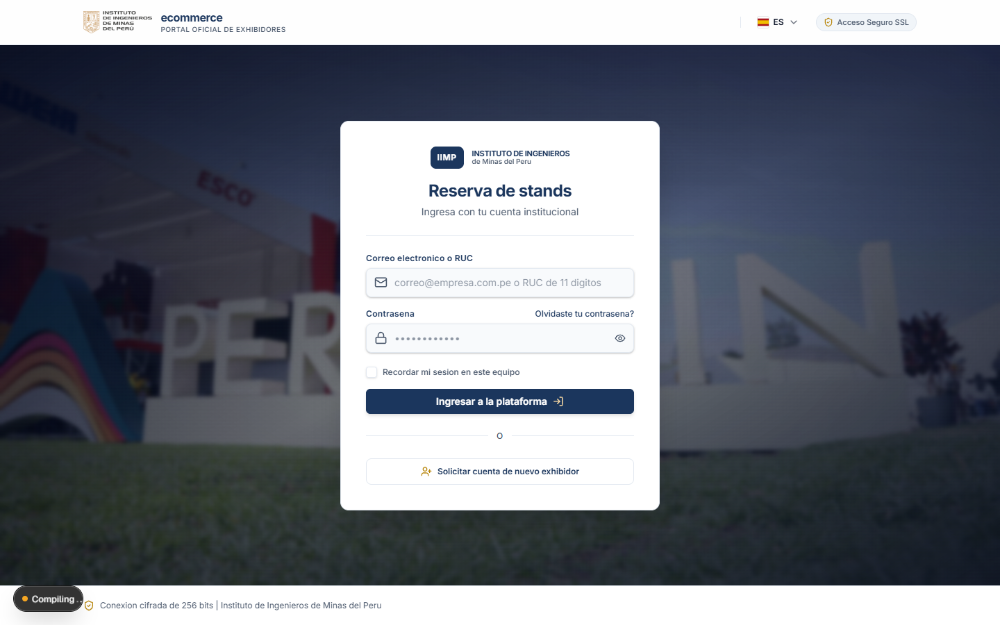
*Figura 1 — Inicio de sesión: correo o RUC + contraseña.*

Tras ingresar, el cliente llega a **Mi Panel**, con el resumen de sus reservas, cuotas
por pagar y los accesos directos al plano.

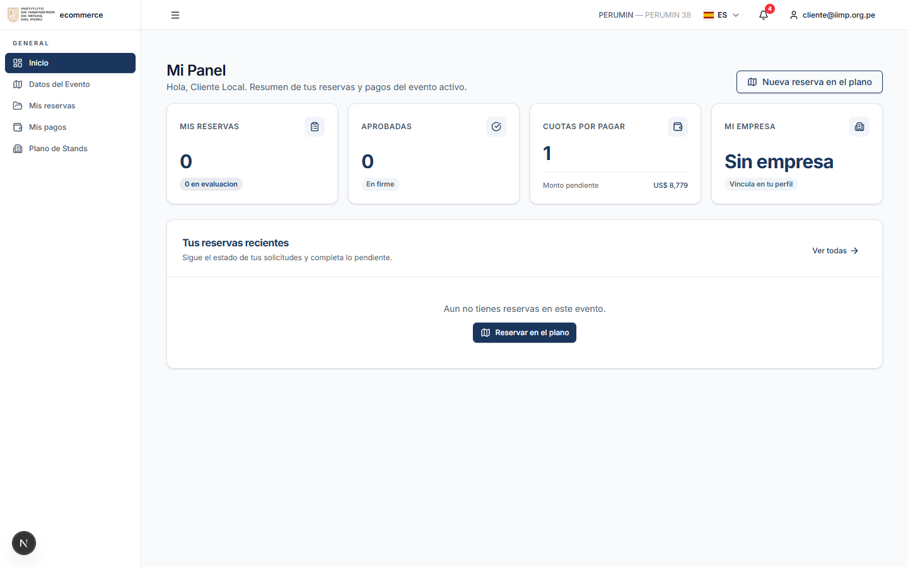
*Figura 2 — Mi Panel: resumen de reservas, cuotas y accesos.*

### 2.4 Recuperar contraseña

1. En el ingreso, haga clic en **"¿Olvidaste tu contraseña?"**.
2. Escriba su correo corporativo y envíe.
3. Recibirá un **enlace para restablecer** (válido 30 minutos). Si no llega, revise
   correo no deseado o solicite apoyo a la Mesa de Ayuda del IIMP.

### 2.5 Cerrar sesión

En la cabecera, abra su usuario (esquina superior derecha) y elija **"Cerrar sesión"**.

---

## 3. Seleccionar evento

1. Al ingresar (o al usar **"Cambiar de evento"** en la cabecera) verá la pantalla
   **"Selecciona tu evento"** con las versiones vigentes agrupadas por vertical
   (PERUMIN, ProExplo, WMC, GESS).
2. Use el buscador o los filtros **Todos / Vigentes / Otras** para ubicar la versión
   correcta.
3. Haga clic en el evento para trabajar en él. Todo el portal (plano, reservas, pagos)
   queda filtrado por el evento seleccionado.

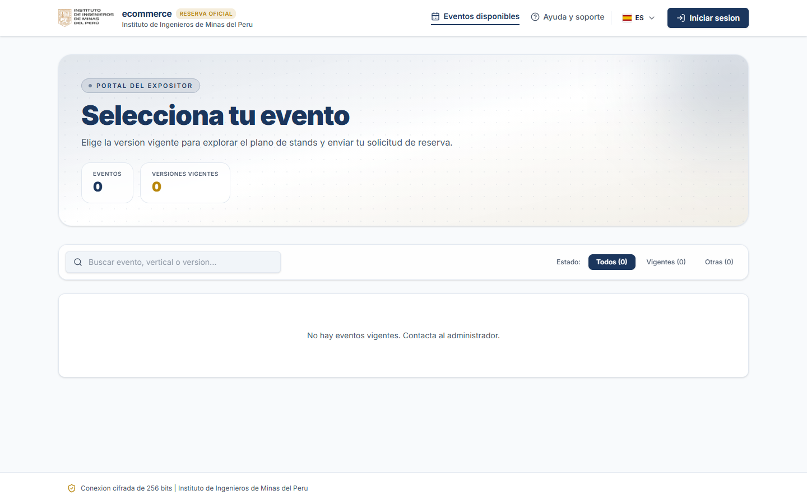
*Figura 3 — Selección de evento (presala): versiones agrupadas por vertical.*

> Si no ve ningún evento vigente, contacte al administrador del IIMP: la publicación de
> versiones la gestiona el IIMP.

---

## 4. El plano de stands

Ingrese desde **"Plano de Stands"** en el menú o desde el botón **"Nueva reserva en el
plano"** de Mi Panel / Mis reservas.

### 4.1 Primera visita: protocolo de reserva

La primera vez que entra al plano en la sesión, se muestra el aviso **"Protocolo de
reserva"** con los pasos del proceso (revisión por áreas, contrato por el SGC y
documentos) y un bloque de **Asistencia para exhibidores**. Ciérrelo con **"Entendido"**;
no vuelve a mostrarse en esa sesión.

### 4.2 Mapa de pabellones (vista macro)

- El mapa muestra los pabellones con un indicador de disponibilidad por color:
  **Disponible** (verde), **Pocos** (amarillo), **Casi lleno** (rojo) y **Sin datos**
  (gris).
- Cada pabellón indica su contador, por ejemplo **"39/49 disp."**.
- Navegación: **arrastre** para mover, **Ctrl + rueda** para zoom.
- Haga clic en un pabellón para entrar a su **plano 3D**.

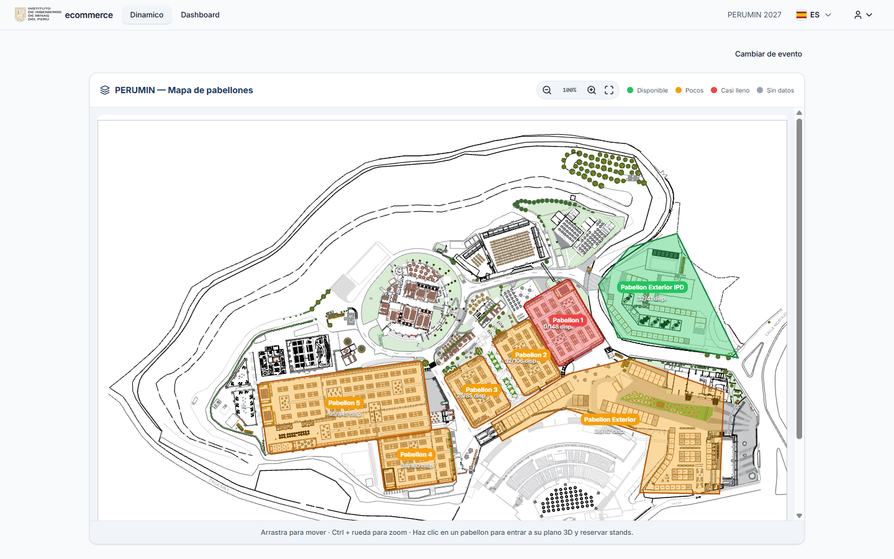
*Figura 4 — Mapa macro: disponibilidad por color y protocolo de reserva (primera visita).*

### 4.3 Plano 3D del pabellón

- **Arrastre** para rotar la vista y use la **rueda** para acercar.
- Cada stand muestra su **número comercial** en una etiqueta azul; los stands
  reservados aparecen en gris (con la **razón social** de la empresa al pasar el
  cursor) y los disponibles en verde/color según su tipo.
- La leyenda identifica los tipos de stand del pabellón, la selección actual y los
  reservados.
- Haga clic en un stand **disponible** para agregarlo al panel **"MI SELECCIÓN"**.
- En el panel puede ver el detalle del stand: **pabellón, área, código, tipo, precio,
  estado** e **imágenes/renders** (cuando existan).
- **Selección múltiple:** puede agregar varios stands; el panel muestra el total y el
  monto acumulado. Para quitar un stand, vuelva a hacer clic sobre él.
- Al terminar, pulse **"Continuar con la Reserva (N)"**.

> Un stand **no reservable** (sin vinculación al plano, reservado o en evaluación) no
> puede agregarse a la selección.

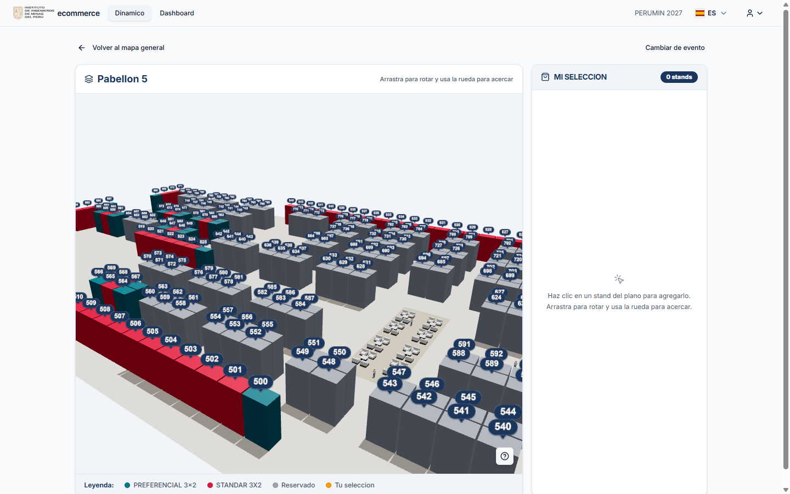
*Figura 5 — Plano 3D del pabellón con el detalle del stand y el panel "MI SELECCIÓN".*

### 4.4 Ver la ubicación de un stand reservado

- Desde **Mis reservas → Ver detalle**, use **"Ver ubicación en el plano"** para abrir
  el **recorte del pabellón** con su stand destacado ("TU STAND") o **"Ver en el mapa"**
  para abrir el plano 3D con el stand preseleccionado.
- Desde **Datos del Evento** también puede consultar el detalle de todos los stands
  (código, tipo, estado, empresa, bloque y precio).

---

## 5. Reserva paso a paso (asistente de 4 pasos)

El asistente **"Proceso de Reserva de Stands"** tiene 4 pasos. Se puede retroceder con
**"Volver"**; la solicitud **recién se crea en el paso 4**. El borrador se conserva si
recarga la página.

### Paso 1 — Tus datos

Complete los **datos comerciales y de facturación**:

- **Comprobante:** elija **Factura** o **Boleta**.
  - Factura: el sistema pedirá **RUC** (11 dígitos) y autocompleta la **razón social**
    (y la dirección fiscal si está disponible) desde SUNAT.
  - Boleta: pedirá **DNI** (8 dígitos) y autocompleta el nombre desde RENIEC.
- **Dirección fiscal** (obligatoria).
- **Contacto comercial y técnico:** persona de contacto, teléfono (celular de 9
  dígitos) y correo electrónico.

Mientras se consulta SUNAT/RENIEC verá la insignia **"Buscando…"**; al validar, la
insignia **"Validado SUNAT/RENIEC"**. Pulse **"Continuar"**.

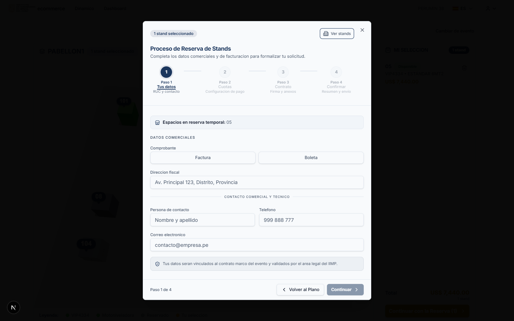
*Figura 6 — Paso 1 "Tus datos": comprobante, RUC/dirección y contacto.*

### Paso 2 — Cuotas

1. Revise el importe: **Valor venta (neto) + IGV (18%) = Total a pagar**. Los precios
   del sistema son netos: el IGV siempre se agrega.
2. Configure **hasta 3 cuotas**:
   - Cada cuota tiene **porcentaje** y **fecha de pago**; los porcentajes deben sumar
     **100%**.
   - Atajos rápidos: **100% (1 cuota)** y **50% + 50% (2 cuotas)**.
   - Reglas de fechas: la primera cuota vence como máximo **1 mes** después de la
     reserva, la segunda hasta **2 meses** y la tercera hasta **3 meses**; debe haber al
     menos **1 día** entre cuotas; tope absoluto **15/07/2027**.
   - Las fechas definitivas se confirman con Facturación del IIMP al momento del pago.
3. Complete los **Datos para el contrato**: razón social del exhibidor, RUC, DNI del
   representante, domicilio, representante legal (nombre completo) y partida
   electrónica (opcional). Estos datos aparecerán en el contrato.
4. Pulse **"Generar contrato y continuar"**: se genera el **contrato borrador** (no
   crea todavía la solicitud).

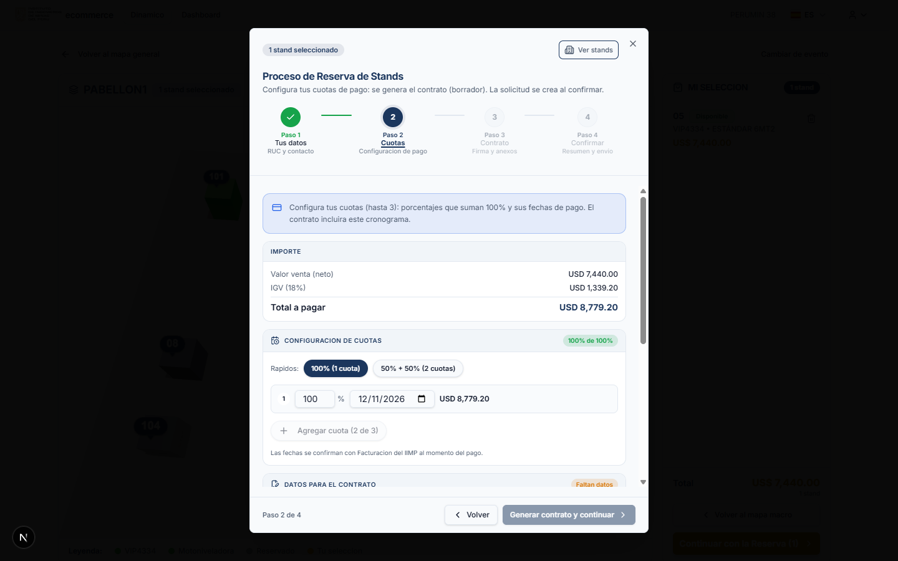
*Figura 7 — Paso 2 "Cuotas": importe con IGV y configuración de cuotas.*

### Paso 3 — Contrato

1. Pulse **"Descargar contrato (DOCX)"** para revisarlo. El contrato ya incluye sus
   datos, los stands, los precios y el cronograma de cuotas.
2. Fírmelo de una de estas dos formas:
   - **Firmar digitalmente:** requiere haber cargado antes su **firma (PNG/JPG)** en
     **Perfil**. El servidor la estampa en el contrato.
   - **Manual:** descargue, firme y luego use **"O adjuntar contrato firmado"** para
     subir el archivo.
3. Adjunte los **3 documentos requeridos** (marcador "0 de 3"):
   - **Ficha RUC** (o equivalente para empresas extranjeras).
   - **Vigencia de Poder** (o equivalente).
   - **DNI o Pasaporte del Representante Legal**.
   - Formatos aceptados: **PDF, JPG, PNG o DOCX**, máximo **10 MB** por archivo.
4. Pulse **"Continuar"**.

> Sin estos documentos el trámite no puede enviarse a la revisión legal.

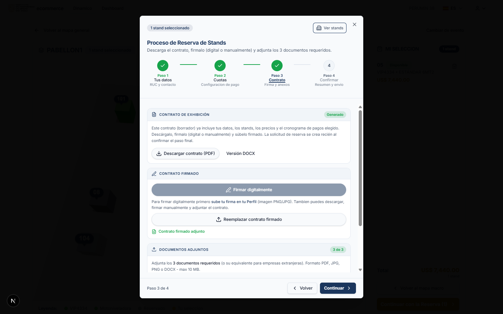
*Figura 8 — Paso 3 "Contrato": descarga, firma y 3 documentos requeridos adjuntos.*

### Paso 4 — Confirmar

1. Revise el resumen: **stands seleccionados**, **facturación y datos comerciales** y
   **contacto**, y la documentación adjunta.
2. Marque la **"Declaración de representante legal"** (acepta ser el representante legal
   de la empresa para esta solicitud).
3. Lea y acepte los **términos y condiciones**.
4. Pulse **"Enviar solicitud"**.

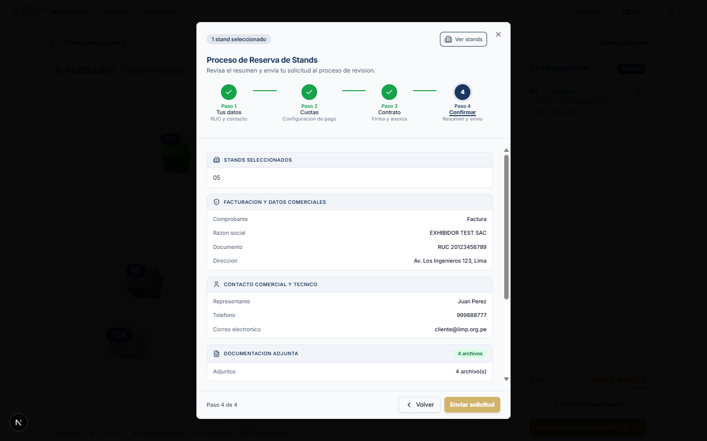
*Figura 9 — Paso 4 "Confirmar": resumen de la reserva antes del envío.*

### ¿Qué ocurre al enviar?

- Los stands pasan a estado **"En evaluación"** y quedan bloqueados para terceros.
- Se **crea la solicitud** y se registra en **Mis reservas**.
- Recibirá un **correo de confirmación** (en su idioma de perfil) y el IIMP recibe la
  notificación interna.
- Comienza la revisión: **Asociado (IIMP) → Legal (SGC)**.

---

## 6. Seguimiento: Mis reservas

Menú **"Mis reservas"**. Cada tarjeta muestra stand, tipo, fecha, estado, empresa,
precio, documentos, coordenadas y una vista del **flujo de evaluación**
(Asociado → Legal (SGC)).

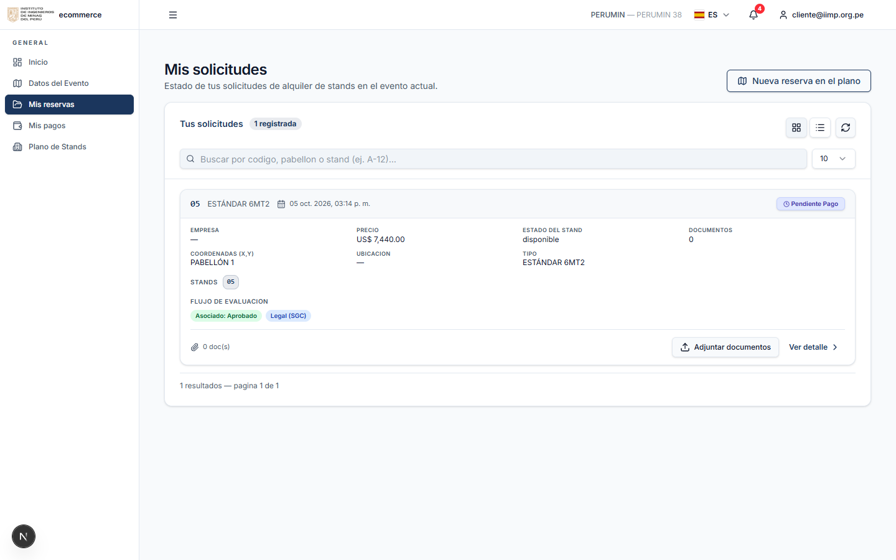
*Figura 10 — Mis reservas: tarjetas con estado y acciones.*

### 6.1 Estados de la solicitud

| Estado en pantalla | Significado |
|---|---|
| **Pendiente** | Solicitud creada; aún no hay respuesta de todas las áreas. |
| **En proceso** | Al menos una revisión ya respondió. |
| **Aprobado** | Todas las revisiones aprobaron. |
| **Rechazado** | Alguna revisión rechazó (ver justificación en el detalle). |
| **Pendiente Pago** | Aprobada y con plan de pago generado; pendiente de pago. |
| **Pagado** | Todas las cuotas fueron confirmadas. |

### 6.2 Detalle de la solicitud

**"Ver detalle"** abre el expediente completo:

- **Información general:** fecha, stand(s), tipo e imágenes del stand.
- **Expediente y documentación:** documentos del **administrador** (contrato y anexos
  del IIMP), **tu contrato firmado** y **tus documentos** adjuntos.
- **Acción requerida:** cuando el IIMP necesita algo de usted, aparece un bloque con la
  tarea y el botón correspondiente.
- **Re-evaluación:** historial de re-evaluaciones, con documentos, fecha y autor.
- **Estado de revisión:** resultado por área (Asociado se revisa en el portal; Legal se
  revisa en el SGC).

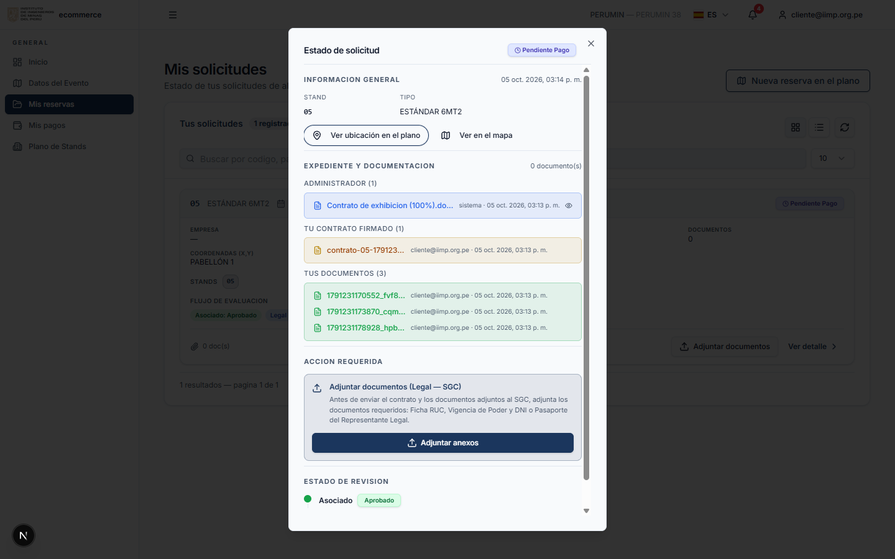
*Figura 11 — Detalle de la solicitud: expediente, documentación y estado de revisión.*

### 6.3 Acciones que puede necesitar realizar

- **"Subir contrato firmado"**: cuando el IIMP publica el contrato para reservas
  múltiples, descárguelo (**"Descargar contrato"**), fírmelo y súbalo.
- **"Adjuntar anexos"** (revisión Legal — SGC): adjunte **Ficha RUC, Vigencia de Poder
  y DNI o Pasaporte del Representante Legal**. Son obligatorios para enviar el trámite.
- **Subsanación SGC:** si Legal devuelve el trámite, verá el motivo y podrá **descargar
  la versión vigente, firmarla y volver a subirla**.
- **"Solicitar Re-evaluación"**: disponible cuando la solicitud está **Rechazada**.
  Permite **adjuntar nuevos documentos**, escribir la **justificación** y enviar la
  solicitud para una nueva revisión.
- **"Ver ubicación" / "Ver en el mapa"**: abre el recorte del pabellón ("TU STAND") o el
  plano con el stand preseleccionado.

---

## 7. Pagos: Mis pagos

Menú **"Mis pagos"**. Muestra el **plan de cuotas** de sus reservas aprobadas.

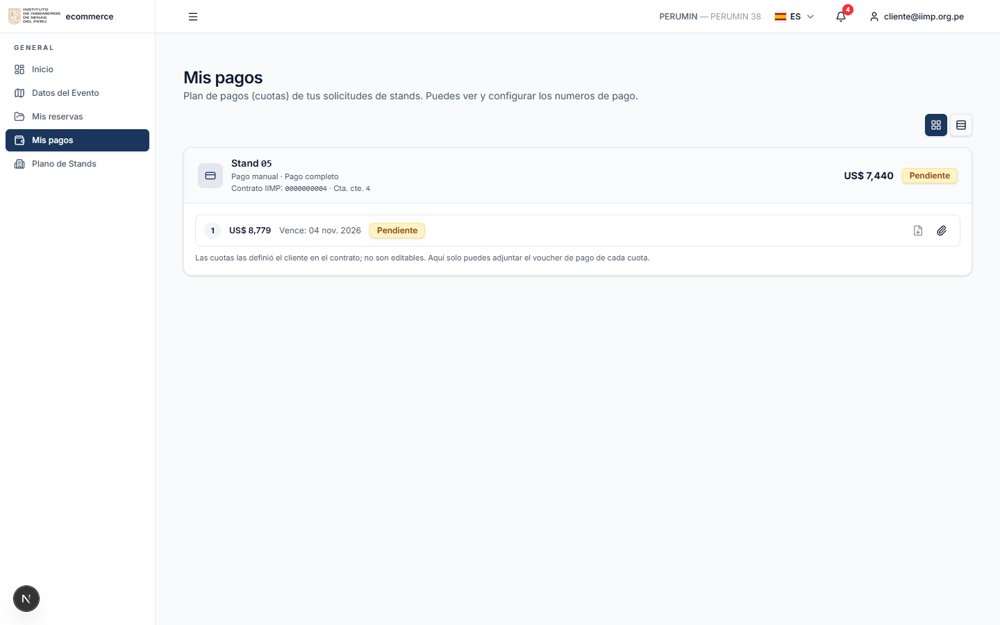
*Figura 12 — Mis pagos: plan de cuotas, voucher y solicitud de factura.*

### 7.1 Cuotas

- Cada cuota muestra: **número, monto, fecha de vencimiento, estado** y sus acciones.
- Si el plan proviene del contrato (definido por usted al reservar), las cuotas **no son
  editables** aquí: solo puede **adjuntar el voucher**. Si el plan lo administra el
  IIMP, puede agregar, editar o eliminar cuotas (la suma no puede superar el total; al
  eliminar, las cuotas restantes se renumeran).

### 7.2 Adjuntar voucher

1. Pulse el icono de voucher en la cuota (**"Adjuntar voucher"** / **"Reemplazar
   voucher"**).
2. Suba el archivo de pago.
3. La cuota queda **bloqueada** y "pendiente de confirmación" hasta que **Facturación
   del IIMP** registre el pago. No se puede editar ni eliminar mientras tenga voucher.

### 7.3 Solicitar factura

Con la reserva **pendiente de pago**, cada cuota tiene el icono **"Solicitar factura"**.
Al usarlo:

1. Se registra la reserva oficial ante el IIMP: los stands pasan a **RESERVADO** y se
   crea el **contrato** y la **cuenta corriente**.
2. Se emite la **factura/boleta de la primera cuota**.
3. La cabecera de la reserva muestra el **Contrato IIMP** y la **Cta. cte.**; la cuota
   muestra la serie y número emitidos.
4. Las cuotas siguientes las factura el IIMP en la fecha de cada cuota.

> La acción no es automática: solicítela cuando corresponda. Evite hacer clic repetido;
> el sistema bloquea el doble registro.

### 7.4 Comprobantes

- Cuando Facturación adjunta el **comprobante fiscal**, aparecerá el enlace
  **"Descargar factura (tipo número)"** en la cuota.
- El **voucher** adjunto por usted queda visible para el IIMP en la bandeja de
  Facturación.

---

## 8. Mi perfil

Menú de usuario → **"Perfil"**.

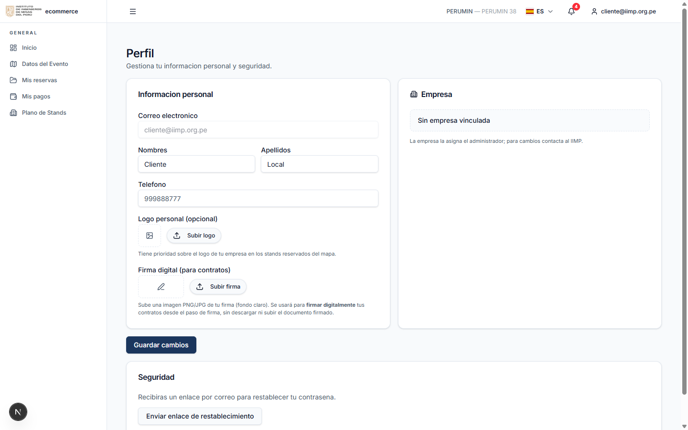
*Figura 13 — Perfil: datos personales, firma digital y seguridad.*

- **Información personal:** correo (solo lectura), nombres, apellidos y teléfono.
- **Logo personal (opcional):** tiene prioridad sobre el logo de la empresa en los
  stands reservados del mapa.
- **Firma digital:** suba una imagen **PNG/JPG** de su firma (fondo claro). Se usará
  para **firmar digitalmente** sus contratos sin descargar ni subir el documento.
- **Empresa:** la asigna el administrador; para cambios, contacte al IIMP. Si su cuenta
  está vinculada a una empresa, podrá completar los datos del **representante legal**
  (DNI validado con RENIEC, partida electrónica, dirección, celular y foto).
- **Seguridad:** **"Enviar enlace de restablecimiento"** envía un correo para cambiar su
  contraseña.

---

## 9. Notificaciones

- **Campana de alertas** (cabecera): avisos internos del turno de revisión y de
  re-evaluaciones. Puede **"Marcar todas leídas"**.
- **Correos:** recibirá notificaciones de confirmación de reserva, resultado de revisión
  y comprobantes, en el **idioma de su perfil** (ES/EN).
- **Selector de idioma ES/EN:** traduce el portal al inglés al instante; los correos y
  documentos usan el mismo idioma.

---

## 10. Preguntas frecuentes

**No veo eventos en "Selecciona tu evento".**
El catálogo de eventos lo publica el IIMP. Contacte a la Mesa de Ayuda para habilitar la
versión.

**No puedo agregar un stand en el plano.**
El stand puede estar reservado, en evaluación o sin vinculación al plano. Reserve otro
stand o consulte a la Mesa de Ayuda.

**¿La solicitud ya es una reserva firme?**
No. Queda **sujeta a revisión** (Asociado → Legal). Los stands permanecen bloqueados
para terceros durante el proceso.

**¿Puedo modificar las cuotas después de reservar?**
Si el plan proviene del contrato, no son editables en Mis pagos; solo puede adjuntar el
voucher. Coordine cualquier cambio con Facturación del IIMP.

**¿Cuándo se emite la factura?**
Al usar **"Solicitar factura"** en Mis pagos: se emite la factura de la primera cuota y
las siguientes en la fecha de cada cuota.

**Me rechazaron la solicitud, ¿qué hago?**
Revise el detalle y la justificación, y use **"Solicitar Re-evaluación"** adjuntando los
documentos corregidos.

**No puedo firmar digitalmente.**
Primero suba su firma (PNG/JPG) en **Perfil**. Alternativamente, descargue el contrato,
fírmelo y adjúntelo.

**No recibí el correo de credenciales/recuperación.**
Revise correo no deseado y confirme con el IIMP que su correo está registrado. El
backoffice puede reenviar credenciales (genera una nueva contraseña temporal).

---

## 11. Glosario

| Término | Significado |
|---|---|
| **IIMP** | Instituto de Ingenieros de Minas del Perú, organizador de los eventos. |
| **Stand** | Espacio de exhibición número único dentro del evento. |
| **Pabellón** | Zona del evento que agrupa stands; se navega desde el mapa macro al plano 3D. |
| **Reserva/Solicitud** | Registro de su pedido de stands; recorre un flujo de revisión. |
| **Asociado** | Área del IIMP que revisa la solicitud en el portal. |
| **Legal (SGC)** | Revisión legal que ocurre en el Sistema de Gestión de Contratos del IIMP. |
| **Contrato de exhibición** | Documento generado automáticamente con sus datos, stands, precios y cuotas. |
| **Voucher** | Comprobante de pago que usted adjunta para que Facturación confirme la cuota. |
| **Ficha RUC / Vigencia de Poder** | Documentos obligatorios para la revisión legal. |
| **IGV** | Impuesto General a las Ventas (18%), se agrega al valor neto. |
| **Re-evaluación** | Nueva revisión solicitada por usted cuando la solicitud fue rechazada. |

---

## 12. Soporte

Para dudas de reserva, documentos, contrato o estado de su solicitud, contacte a la
**Mesa de Ayuda del IIMP** (datos de contacto configurados por el IIMP y visibles en el
aviso "Protocolo de reserva" del plano).
