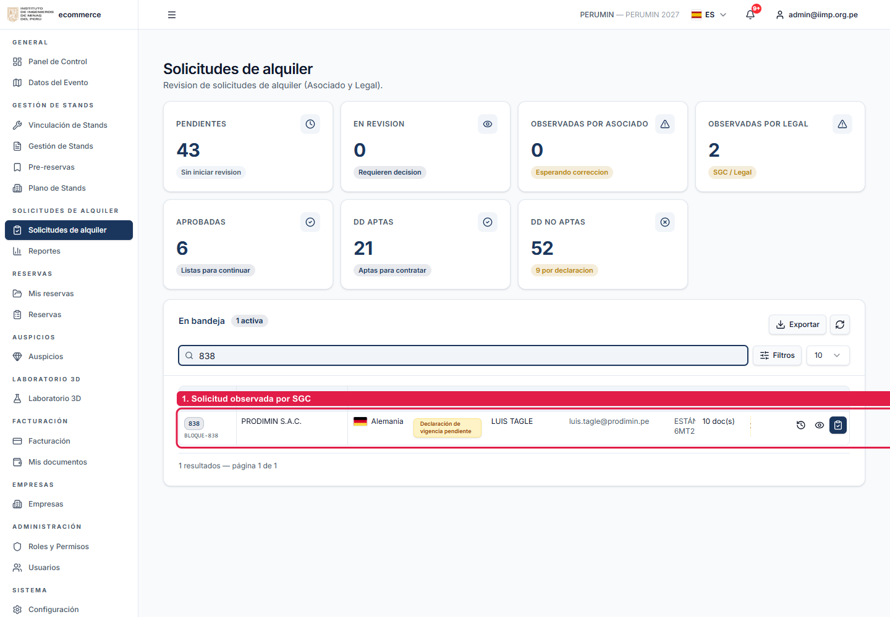
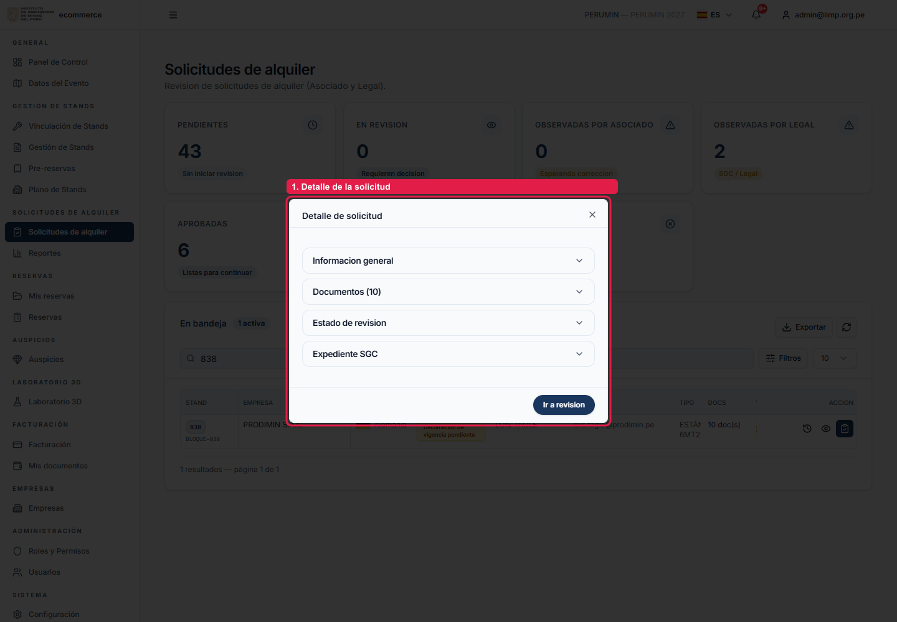
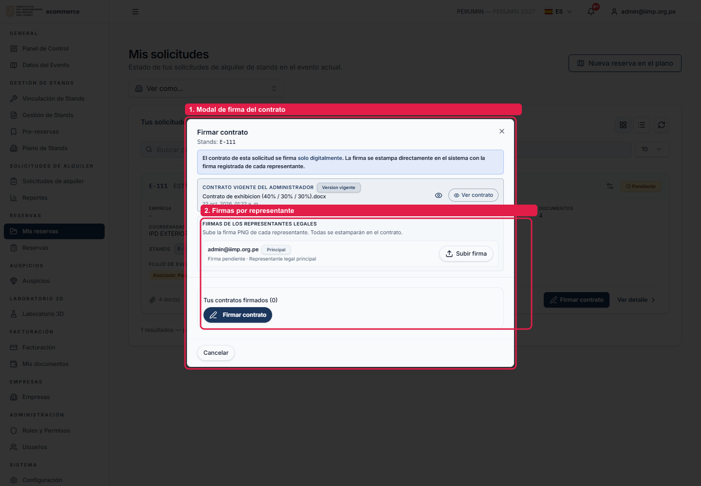

# Manual de subsanación de observaciones del SGC

> Manual operativo para corregir observaciones del Sistema de Gestión de Contratos
> (SGC) desde el portal de stands del IIMP.
>
> Las capturas fueron tomadas con Playwright sobre QA y están anotadas para señalar
> el paso o la zona relevante. Los datos mostrados son de prueba.

## 1. Objetivo

Explicar, de principio a fin, cómo interpretar una observación del SGC, corregirla,
firmar el contrato cuando corresponda y solicitar una nueva revisión sin perder
documentos ni romper el expediente.

Aplica a:

- observaciones del contrato;
- observaciones de anexos;
- documentos faltantes;
- varios faltantes en una misma devolución;
- adjuntos agrupados v11;
- casos antiguos con o sin metadatos SGC;
- firma digital, firma con cursor y firma con sello;
- alta o baja de representantes/firmantes adicionales.

## 2. Reglas que nunca se deben romper

1. El SGC es la autoridad. Una observación no se considera resuelta hasta que el SGC
   la marca como `resolved` o acepta el reenvío.
2. No se elimina historial. Las correcciones crean versiones nuevas; los documentos
   anteriores quedan como `reemplazado`.
3. Una **observación individual con `documentId`** se corrige con una **versión nueva
   de ese mismo documento**.
4. Un **faltante con `documentId: null`** se corrige con un **archivo nuevo**.
5. Un **grupo v11** se corrige con `observationId` + `pieceId` por cada pieza.
6. Nunca se adivina una pieza, un `documentId` o un firmante.
7. No se modifica un expediente aprobado, vigente, cerrado, finalizado o archivado.
8. No se reemplaza una firma del cliente por una firma del administrador.
9. Toda corrección urgente debe quedar auditada: quién, cuándo, qué archivo y por qué.
10. Si el SGC devuelve `422`, leer el mensaje: normalmente indica exactamente qué
    versión o archivo falta.

## 3. Roles

| Rol | Puede hacer |
|---|---|
| Cliente / empresa | Ver sus observaciones, subir correcciones, firmar digitalmente, solicitar nueva revisión |
| Asociado | Revisar la solicitud, observar, habilitar contrato, aprobar |
| Legal | Revisar en el SGC, observar, aprobar o devolver |
| Administrador | Ver como empresa, corregir, regenerar contrato, firmar en modo prueba, reenviar |
| Soporte autorizado | Ejecutar correcciones excepcionales con auditoría |

## 4. Flujo general

```text
SGC devuelve expediente
        |
        v
Portal sincroniza observaciones
        |
        v
Cliente/operador abre "Mis solicitudes"
        |
        v
Revisa "Acción requerida"
        |
        +--> Documentos: versión nueva o archivo nuevo
        |
        +--> Contrato: regenerar, firmar y enviar
        |
        v
"Subir / reemplazar documentos" o "Firmar contrato"
        |
        v
"Solicitar nueva revisión"
        |
        v
SGC valida y vuelve a observar, aprueba o rechaza
```

## 5. Ingreso y localización de la solicitud

1. Ingresar al portal.
2. Abrir **Mis solicitudes** o, si se es administrador, **Solicitudes de alquiler**.
3. Buscar por código de stand, empresa o código de solicitud.
4. Identificar el estado **Observado**.
5. Abrir **Ver detalle** o **Revisar solicitud**.



### Qué revisar antes de tocar un documento

- Estado de la solicitud: `Observado`.
- Estado SGC: `observed` o `rejected`.
- Etapa SGC: normalmente `drafting` para corrección.
- Observaciones abiertas: contrato, anexos o faltantes.
- Si el botón dice **Solicitar nueva revisión**, el sistema ya detecta una corrección
  registrada; no significa que el SGC ya la haya aceptado.

## 6. Leer el detalle sin confundir acciones

El detalle puede mostrar varias secciones. No son lo mismo:

| Sección | Qué significa | Acción |
|---|---|---|
| Documentos observados por el área legal | Anexos concretos que deben corregirse | Subir versión o archivo nuevo |
| Contrato observado por el área legal | El contrato debe corregirse y firmarse | Regenerar y firmar |
| Estado de revisión | Historial del flujo local y SGC | Solo lectura |
| Expediente y documentación | Historial de archivos y versiones | Revisar, no borrar |



### 6.1 No confundir “Documentos” con “Contrato”

- **Documentos** agrupa Ficha RUC, Vigencia de Poder, DNI, adjuntos adicionales y
  faltantes.
- **Contrato** es el documento principal. Se firma digitalmente; no se sube a mano.

## 7. Corregir documentos del cliente

Abrir **Subir / reemplazar documentos**. El modal muestra únicamente los documentos
pendientes y su tipo.



### 7.1 Versión corregida de un adjunto existente

Se usa cuando el SGC ya tiene un documento y pide corregirlo.

1. Identificar la fila con el badge **Versión corregida**.
2. Pulsar **Subir versión corregida**.
3. Seleccionar el archivo corregido.
4. Verificar que la fila pase a **Listo para enviar**.
5. Repetir para cada documento observado.

Regla: el SGC valida por `documentId`, no por nombre de archivo. Un archivo nuevo con
otro nombre no reemplaza el adjunto observado.

### 7.2 Archivo nuevo para un faltante

Se usa cuando el SGC pide un documento que todavía no existe.

1. Identificar la fila con el badge **Archivo nuevo**.
2. Pulsar **Adjuntar archivo nuevo**.
3. Subir el archivo con el título exacto solicitado.
4. Verificar que la fila pase a **Listo para enviar**.

### 7.3 Varios faltantes con el mismo título o títulos similares

Ejemplo típico: `documento1`, `documento2`, o dos “Vigencia de poder”.

- Cada faltante necesita **un archivo propio**.
- No usar un archivo para cubrir dos faltantes.
- No confundir un faltante con una versión existente.
- Si el mismo título aparece dos veces, revisar el badge:
  - **Versión corregida** = adjunto existente;
  - **Archivo nuevo** = documento que falta.

### 7.4 Observación agrupada v11 (`pieces[]`)

El SGC puede pedir varios archivos dentro de una sola observación.

1. La fila muestra las piezas esperadas.
2. Cada pieza tiene su propio estado: `Recibido`, `Listo para enviar` o `Pendiente`.
3. Subir cada archivo en su pieza.
4. No se habilita el reenvío hasta que todas las piezas tengan archivo.
5. Cada archivo se envía con `observationId` + `pieceId`.

### 7.5 Casos antiguos

#### Antiguo con `documentId`
Se corrige con una versión nueva del mismo documento.
No enviar `observationId` suelto.

#### Antiguo con faltante individual
Se envía como archivo nuevo.

#### Antiguo agrupado sin `pieces[]`
No se puede reconstruir la relación archivo-pieza desde el portal. Opciones:

1. Pedir al SGC que reemita la observación con `pieces[]`.
2. Usar corrección administrativa, si el expediente y la política lo permiten.
3. Escalar a soporte; no adivinar.

### 7.6 Casos con documentos históricos

Los documentos `reemplazado` no cuentan como corrección vigente. No borrar el
historial. Si una corrección anterior quedó reemplazada por error, volver a subir el
archivo como versión o como nuevo según el badge.

## 8. Corregir el contrato

### 8.1 Contrato observado y pendiente de regeneración

Cuando el SGC observa el contrato:

1. El portal detecta la observación.
2. Se muestra **Preparando contrato corregido**.
3. El botón de firma queda deshabilitado.
4. El sistema regenera el contrato con los datos actuales de la empresa, incluidos
   representantes y partida electrónica.
5. No se debe cerrar el expediente ni crear un contrato manual paralelo.

### 8.2 Contrato corregido listo

Cuando la regeneración termina:

1. Aparece **Contrato corregido listo**.
2. Se muestra **Contrato corregido para firmar**.
3. Se habilitan las firmas.
4. Se puede abrir **Firmar contrato corregido**.

### 8.3 Firmar digitalmente

1. Abrir **Firmar contrato** o **Firmar contrato corregido**.
2. Revisar el contrato vigente del administrador.
3. Cargar la firma PNG de cada representante.
4. Verificar que todos los firmantes estén completos.
5. Abrir la vista de firma.
6. Firmar las secciones indicadas.
7. Confirmar la firma.
8. El sistema genera el contrato firmado y lo adjunta como historial nuevo.

No se debe subir un contrato firmado manualmente cuando la política es firma digital.

## 9. Firmar con cursor

1. En la vista de firma, seleccionar el firmante.
2. Elegir **Firma con cursor**.
3. Dibujar la firma en el lienzo.
4. Confirmar.
5. Verificar que el firmante muestre **2/2 secciones firmadas**.
6. Repetir con cada firmante.

## 10. Firmar con sello

1. En la vista de firma, seleccionar el firmante.
2. Elegir **Sello**.
3. Revisar el sello generado con nombre y apellidos.
4. Arrastrar el sello a la zona de firma.
5. Confirmar.
6. Verificar que la sección quede firmada.
7. Repetir para el contrato y la declaración.

El sello no reemplaza una firma del cliente: es una representación visual autorizada
del firmante seleccionado.

## 11. Agregar o quitar representantes/firmantes

La vista de firma permite administrar firmantes adicionales.

1. Abrir **¿Necesitas quitar o agregar un firmante adicional?**
2. Agregar el representante con nombre, documento, correo y datos requeridos.
3. Guardar.
4. El sistema regenera el contrato con los nuevos firmantes.
5. Volver a cargar o capturar las firmas.
6. Verificar que el número de firmantes y secciones coincida.

Reglas:

- No agregar un firmante que no tenga sustento legal.
- No eliminar un firmante con firma ya estampada sin regenerar el contrato.
- Si se agregó un representante, el contrato anterior queda como historial.
- Si el expediente ya está aprobado, no se puede cambiar el contrato.

## 12. Solicitar nueva revisión

1. Confirmar que todas las observaciones abiertas tienen archivo o versión.
2. Pulsar **Solicitar nueva revisión**.
3. El backend sube las versiones y faltantes.
4. Se ejecuta `/resend` una sola vez por ronda.
5. El SGC pasa a revisión o devuelve una nueva observación.

No pulsar varias veces. Si el SGC responde `422`, leer el mensaje y corregir el
documento indicado; no reintentar a ciegas.

## 13. Errores frecuentes

| Error | Causa | Solución |
|---|---|---|
| `Indica observationId y pieceId válidos` | Se envió `observationId` suelto o pieza inválida | Enviar ambos solo en grupo v11 |
| `Un adjunto corregido debe subirse como versión nueva` | Se envió un archivo nuevo para un adjunto existente | Subir por la fila **Versión corregida** |
| `Todavía falta: Adjunto corregido...` | Falta versión de un documento existente | Subir versión del `documentId` indicado |
| `Todavía falta: ...` con faltante | Falta un archivo nuevo | Subir por **Archivo nuevo** |
| `409` pieza ajena a la devolución | `pieceId` no corresponde a la observación abierta | Sincronizar y usar la pieza correcta |
| `422` flujo activo | Ya se reenvió la ronda | No repetir; esperar revisión |
| `500` al reenviar | Error interno o SGC devolvió un error no mapeado | Revisar logs; no reintentar sin diagnóstico |
| Contrato en regeneración | Aún no existe versión corregida | Esperar y refrescar |
| Botón de subir oculto | No hay observaciones abiertas | Usar **Solicitar nueva revisión** |
| Documento “reemplazado” no cuenta | Es historial | Subir una versión vigente |

## 14. Casos cubiertos por este manual

- Observación de contrato.
- Observación de Ficha RUC.
- Observación de Vigencia de Poder.
- Observación de DNI.
- Faltante individual.
- Varios faltantes (`documento1`, `documento2`).
- Faltante con el mismo título que una versión existente.
- Observación agrupada v11 con `pieces[]`.
- Caso antiguo con `documentId`.
- Caso antiguo agrupado sin `pieces[]`.
- Contrato en regeneración.
- Contrato corregido listo.
- Firma con cursor.
- Firma con sello.
- Alta de representante/firmante adicional.
- Baja de firmante adicional.
- Reenvío y nueva revisión.
- Error `400`, `409`, `422` y `500`.
- Documentos históricos y reemplazados.

## 15. Checklist final

- [ ] La solicitud sigue en `observado`.
- [ ] No está aprobada, vigente, cerrada, finalizada ni archivada.
- [ ] Cada observación abierta tiene su archivo o versión.
- [ ] Las versiones usan el `documentId` correcto.
- [ ] Los faltantes usan `documentId: null`.
- [ ] Las piezas v11 usan `pieceId`.
- [ ] El contrato corregido fue firmado por todos los representantes.
- [ ] No se eliminó ningún documento.
- [ ] Se pulsó **Solicitar nueva revisión** una sola vez.
- [ ] Se verificó el estado en el SGC después del reenvío.

## 16. Referencias

- `docs/05-integraciones/integracion-sgc.md`
- `docs/06-operacion/procedimiento-correccion-excepcional-sgc.md`
- `APIS_USE_HOOKS (11).md`
- `API_HOOK_SCENARIOS (2).md`
- `src/components/solicitudes/cliente-upload-modal.tsx`
- `src/lib/shared/utils/solicitud-documentos.ts`
- `src/application/sgc-integracion/sgc-integracion-service.ts`
